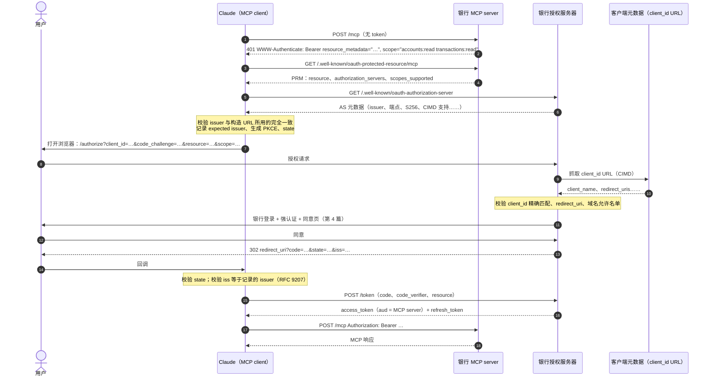
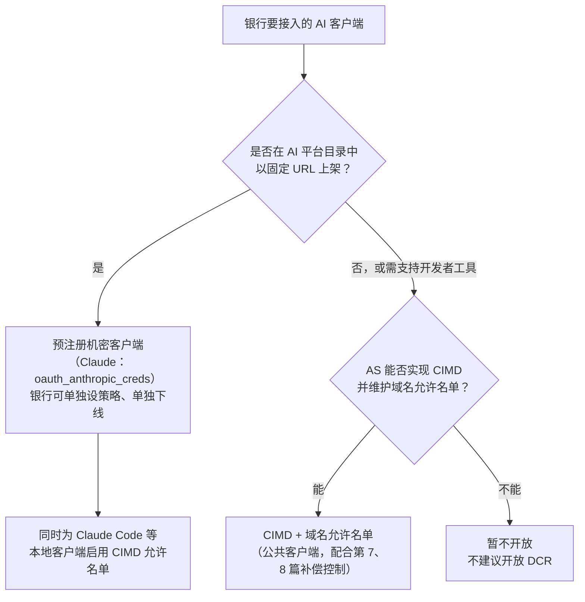

# 第 3 篇｜AuthN（上）：MCP 授权规范逐条拆解（2026-07-28）

> 系列：《让 AI 替你办银行业务：面向 MCP Connector 的身份认证与授权设计》
> 规范基线：MCP `2026-07-28`（Authorization、Client Registration、Authorization Server Discovery、Security Considerations）；OAuth 2.1 `draft-ietf-oauth-v2-1-13`；RFC 8414 / 8707 / 9207 / 9728；draft-ietf-oauth-client-id-metadata-document-00
> 撰写日期：2026-10-23

---

## 0. 用户点下「连接」之后

用户在 Claude 的 connector 设置里输入 `https://mcp.examplebank.hk/mcp`，点「连接」。接下来几秒钟里，Claude 和银行之间会发生大约十次 HTTP 往返。本篇逐一拆开这些往返：每一步依据哪条规范、银行要提供什么端点和字段、哪里最容易出错。

先给结论。银行要准备的东西：

| 组件 | 必须提供 | 依据 |
|---|---|---|
| MCP server | 对未认证请求返回 `401` + `WWW-Authenticate: Bearer resource_metadata="…"` | RFC 9728 §5.1；MCP Authorization |
| MCP server | Protected Resource Metadata 文档 | RFC 9728（MCP：MUST） |
| MCP server | 校验 token 的 `aud` 是自己 | RFC 8707；MCP：MUST |
| 授权服务器 | AS 元数据（RFC 8414 或 OIDC Discovery，至少其一） | MCP：MUST |
| 授权服务器 | 授权码 + PKCE（S256），元数据里声明 `code_challenge_methods_supported` | OAuth 2.1；MCP：缺失则客户端 MUST 拒绝继续 |
| 授权服务器 | 客户端注册方式：CIMD／预注册／DCR 至少其一 | MCP Client Registration |
| 授权服务器 | 授权响应中的 `iss` 参数（建议） | RFC 9207；MCP：AS SHOULD，客户端 MUST 校验 |

---

## 1. 规范是怎么演进到今天的

MCP 授权规范在一年多里改了四版。银行团队读到的博客、SDK 示例很可能分属不同版本，先理清脉络：

| 版本 | 授权相关的关键变化 |
|---|---|
| `2025-03-26` | 首次引入基于 OAuth 2.1 的授权框架 |
| `2025-06-18` | 明确 MCP server 是 **OAuth 资源服务器**，授权服务器可以独立部署；MCP server MUST 实现 RFC 9728；客户端 MUST 使用 RFC 8707 `resource` 参数 |
| `2025-11-25` | 引入 **Client ID Metadata Document（CIMD）** 作为推荐注册方式；支持 OIDC Discovery；通过 `WWW-Authenticate` 做增量授权（scope challenge）；引入 URL 模式 elicitation |
| `2026-07-28`（当前） | **DCR 被标记为 Deprecated**；RFC 9207 `iss` 校验（AS SHOULD 发送，客户端 MUST 校验）；DCR 须声明 `application_type`；客户端凭据须按 issuer 绑定；协议整体**无状态化**（取消会话与 `initialize` 握手） |

> 前两版的要点为笔者根据各版规范与 changelog 的整理；后两版已对照 `modelcontextprotocol.io` 上的 changelog 原文核对。

对银行最重要的两个变化是：**MCP server 只做资源服务器**（银行可以复用现有授权服务器），以及 **CIMD 取代 DCR 成为推荐的注册方式**（银行不必再开放「任何人都能注册客户端」的端点）。

---

## 2. 全流程



下面按步骤展开。

---

## 3. 第 1–4 步：资源服务器发现（RFC 9728）

### 3.1 401 挑战

MCP server 收到不带 token 的请求，返回：

```http
HTTP/1.1 401 Unauthorized
WWW-Authenticate: Bearer resource_metadata="https://mcp.examplebank.hk/.well-known/oauth-protected-resource/mcp",
                         scope="accounts:read transactions:read"
```

MCP `2026-07-28` 规定 MCP server 至少实现两种发现机制之一：`WWW-Authenticate` 中的 `resource_metadata`，或 well-known URI；客户端两者都必须支持，优先用头部给出的 URL。Claude 的 connector 文档写得更严格：**必须返回 `401`**，Claude 不会理会 `200` 响应上的 `WWW-Authenticate`。

`scope` 参数不是必须的，但对银行很重要。规范的「Scope Selection Strategy」规定：客户端优先使用 401 里的 `scope`；没有时，申请 PRM `scopes_supported` 里的**全部** scope。所以银行要么在 401 里给出最小 scope，要么让 `scopes_supported` 只包含最小基础集。示例实现两者都做了：只放 `accounts:read transactions:read`，其余权限在运行时通过 `insufficient_scope` 增量申请（第 5 篇）。

### 3.2 Protected Resource Metadata

```json
{
  "resource": "https://mcp.examplebank.hk/mcp",
  "authorization_servers": ["https://auth.examplebank.hk"],
  "scopes_supported": ["accounts:read", "transactions:read"],
  "bearer_methods_supported": ["header"],
  "resource_name": "示例银行（香港）AI 连接",
  "dpop_signing_alg_values_supported": ["ES256", "PS256"]
}
```

三个易错点：

1. **`resource` 必须与用户输入的 MCP URL 完全一致，包括路径。** 它同时是客户端 `resource` 参数的值，也是 access token `aud` 的值。差一个尾部斜杠就会导致 audience 校验失败。规范建议统一用不带尾部斜杠的形式。
2. **well-known 路径要带上 MCP 端点路径**：`/mcp` 的元数据位于 `/.well-known/oauth-protected-resource/mcp`（RFC 9728 的路径插入规则）。
3. **`authorization_servers` 只写一个。** 规范允许多个，但 Claude 文档说明它只使用第一项，不会回退到后面的条目。

---

## 4. 第 5–6 步：授权服务器发现（RFC 8414 / OIDC Discovery）

客户端按顺序尝试：

- issuer 不带路径时：`/.well-known/oauth-authorization-server`，然后 `/.well-known/openid-configuration`；
- issuer 带路径（如 `https://auth.examplebank.hk/retail`）时：先试路径插入的 OAuth 元数据、再试路径插入的 OIDC、最后试路径追加的 OIDC。

拿到文档后，客户端 MUST 校验文档中的 `issuer` 与构造 URL 所用的 issuer **完全相同**，否则丢弃。这一条防的是攻击者在自己的域名上发布一份声称 `"issuer": "https://auth.examplebank.hk"` 的元数据。

银行 AS 元数据中，与 MCP 客户端交互最相关的字段（完整示例见 [`code/authz-server/as_metadata.json`](../code/authz-server/as_metadata.json)）：

```json
{
  "issuer": "https://auth.examplebank.hk",
  "code_challenge_methods_supported": ["S256"],
  "authorization_response_iss_parameter_supported": true,
  "client_id_metadata_document_supported": true,
  "token_endpoint_auth_methods_supported": ["none", "private_key_jwt", "tls_client_auth"],
  "authorization_details_types_supported": ["https://examplebank.hk/rar/payment-draft/v1"],
  "dpop_signing_alg_values_supported": ["ES256", "PS256"]
}
```

- **`code_challenge_methods_supported` 缺失 = 客户端拒绝继续。** MCP 规范把它定为 MUST，因为 OAuth 2.1 和 PKCE 规范本身没有定义 PKCE 支持的发现机制。很多银行现有的 OIDC Provider 元数据里没有这个字段，这是最常见的「连不上」原因之一。
- **`authorization_response_iss_parameter_supported: true`**：声明后，客户端在授权响应缺少 `iss` 时 MUST 拒绝；规范预告下一版会把 AS 发送 `iss` 升级为 MUST。

---

## 5. 客户端注册：CIMD、预注册、DCR

### 5.1 三种方式与优先级

MCP `2026-07-28` 定义了三种方式，客户端按以下优先级选择：

1. 已有该授权服务器的**预注册**信息 → 直接用；
2. AS 元数据声明 `client_id_metadata_document_supported` → 用 **CIMD**；
3. AS 有 `registration_endpoint` → 用 **DCR**（已 Deprecated，仅为向后兼容保留）；
4. 都没有 → 让用户手工输入客户端信息。

**CIMD 的机制**：`client_id` 本身就是一个 HTTPS URL，指向一份 JSON 元数据。AS 在授权请求到来时抓取它，校验其中的 `client_id` 与 URL 完全一致、`redirect_uris` 包含本次请求的回调地址，然后在同意页上显示 `client_name`。CIMD 的价值在于：**客户端身份锚定在一个域名上**，AS 可以用「域名允许名单」来决定接受谁。

### 5.2 Claude 的实际行为（撰写时）

Claude 的 connector 文档给出了几点比规范更具体的约束，银行接入前必须核对：

| 事项 | Claude 的行为 |
|---|---|
| 何时用 CIMD | 仅当 AS 元数据**同时**声明 `client_id_metadata_document_supported: true` 且 `token_endpoint_auth_methods_supported` 包含 `"none"`；否则回退 DCR |
| CIMD／DCR 下的客户端类型 | **公共客户端**（token 端点不做客户端认证） |
| 机密客户端选项 | `oauth_anthropic_creds`：银行为 Claude 创建机密客户端，把 client ID 和 secret 交给 Anthropic 保管；仅用于目录中上架的 connector，且不适用于按客户区分 URL 的场景 |
| 托管端回调地址 | `https://claude.ai/api/mcp/auth_callback`（网页版、桌面版、移动端、Cowork 共用） |
| Claude Code | 使用自己的 CIMD 与环回地址回调（`http://localhost/callback`、`http://127.0.0.1/callback`，端口随机，AS 需忽略端口匹配） |
| DCR 的副作用 | 每次全新连接都会注册一个新客户端，AS 上会累积大量客户端 |
| 超时 | 发现、注册、token 端点 10 秒；refresh 请求 30 秒 |
| 出站 IP | `160.79.104.0/21`（银行 WAF／条件访问需放行） |

### 5.3 银行该怎么选



几点理由：

- **不要开放 DCR。** 开放 DCR 意味着任何人都能在银行 AS 上注册一个客户端、填任意回调地址。银行再怎么在同意页上提示，也很难让用户分辨「示例理财助手」和「示例理財助手」。DCR 已被 MCP 标为 Deprecated，正好借机不做。
- **CIMD 一定要配允许名单。** MCP 安全最佳实践列出了几种 CIMD 信任策略：允许名单、接受任意 HTTPS、信誉检查等。对银行只有允许名单是合理的：`claude.ai` 在名单里，是因为银行对 Anthropic 做过第三方尽调（第 11 篇），而不是因为它能托管一个 JSON 文件。
- **CIMD 的 SSRF 风险在 AS 一侧。** AS 会根据外部输入的 URL 发起请求，必须限制协议、拒绝私有地址、不跟随重定向、限制响应大小。参考实现见 [`code/authz-server/cimd_policy.py`](../code/authz-server/cimd_policy.py)。
- **环回回调的冒充风险。** CIMD 能证明域名控制权，却证明不了本机上是哪个进程在监听 `localhost`。规范要求 AS 在同意页上清晰显示回调地址主机名，对仅有环回回调的客户端额外警示。对银行而言，若不需要支持本地开发工具，可以不接受环回回调。

---

## 6. 第 7–16 步：授权码 + PKCE

授权请求示例：

```http
GET /authorize?response_type=code
  &client_id=examplebank-claude-hosted
  &redirect_uri=https%3A%2F%2Fclaude.ai%2Fapi%2Fmcp%2Fauth_callback
  &scope=accounts%3Aread%20transactions%3Aread%20offline_access
  &resource=https%3A%2F%2Fmcp.examplebank.hk%2Fmcp
  &code_challenge=E9Melhoa2OwvFrEMTJguCHaoeK1t8URWbuGJSstw-cM
  &code_challenge_method=S256
  &state=af0ifjsldkj
```

- **`resource`**：MCP 规定授权请求和 token 请求都 MUST 带上，值为 MCP server 的规范 URI。银行 AS 据此把 token 的 `aud` 设为该 URI（第 6 篇）。
- **`offline_access`**：Claude 文档说明，若 AS 的 `scopes_supported` 列出了 `offline_access`，它会自动追加以获取 refresh token。银行若不想给某类客户端 refresh token，应在 AS 策略层面控制，而不是指望客户端不申请。
- **PKCE**：Claude 每次都发送 S256 challenge。
- **回调校验**：客户端 MUST 先按 RFC 9207 校验 `iss`，再去兑换授权码——这是对 mix-up 攻击的防御：一个恶意 AS 可能诱导客户端把诚实 AS 签发的授权码送到恶意 token 端点。规范特别指出，PKCE 本身挡不住这种攻击，因为 `code_verifier` 会一起被送过去。

**关于 PAR。** FAPI 2.0 要求使用 PAR（RFC 9126）。MCP 规范没有要求客户端支持 PAR，撰写时 Claude 的 connector 文档也未提及。如果银行 AS 对所有客户端强制 `require_pushed_authorization_requests`，很可能导致 AI 客户端无法连接。这是第 7 篇 FAPI 差距分析的第一项。

---

## 7. 无状态协议对授权意味着什么

`2026-07-28` 取消了协议层会话（`Mcp-Session-Id`）和 `initialize` 握手，每个请求都自带协议版本和客户端能力。对银行有三点直接影响：

1. **每个请求都必须独立认证与授权。** 不存在「会话建立时校验过一次」这回事。规范原文：authorization MUST be included in every HTTP request。
2. **跨请求状态要用显式句柄，且句柄不是凭证。** 规范的安全最佳实践把旧的「会话劫持」改写为「State Handle Hijacking」：服务端 MUST NOT 把持有句柄当作认证，SHOULD 把句柄绑定到已认证用户（例如按 `<user_id>:<handle>` 存储）。示例代码中的支付草稿 ID 就是这样的句柄：`getOwnedDraft(draftId, sub)` 只在 `sub` 匹配时返回。
3. **多轮交互（MRTR）的 `requestState` 会经过客户端往返**，影响授权的内容 MUST 做完整性保护。示例用 SDK 的 `createRequestStateCodec`（HMAC + 过期 + 绑定 `sub`）。我们在本地测试中篡改了一个字节，服务器返回 `-32602 Invalid or expired requestState`。

---

## 8. 代码：401 挑战与 PRM

完整代码见 [`code/mcp-server/src/auth/middleware.ts`](../code/mcp-server/src/auth/middleware.ts) 与 [`server.ts`](../code/mcp-server/src/server.ts)。核心片段：

```ts
// server.ts —— RFC 9728：resource 必须与用户在客户端里填写的 MCP URL 完全一致（含路径）
app.get(`/.well-known/oauth-protected-resource${config.resourceUrl.pathname}`, (_req, res) => {
  res.json({
    resource: config.resourceUrl.href,
    authorization_servers: [config.issuer],
    scopes_supported: baselineScopes,
    bearer_methods_supported: ['header'],
    resource_name: '示例银行（香港）AI 连接',
    dpop_signing_alg_values_supported: ['ES256', 'PS256'],
  });
});

app.post(config.resourceUrl.pathname, express.json({ limit: '64kb' }), bankAuth, (req, res) =>
  toNodeHandler(mcpHandler)(req, res, req.body),
);
```

```ts
// middleware.ts —— 首次 401 给出最小基础 scope
function challenge(res: Response, status: 401 | 403, error?: string, description?: string, scheme = 'Bearer') {
  const parts = [`resource_metadata="${resourceMetadataUrl}"`];
  if (error) parts.unshift(`error="${error}"`);
  if (description) parts.push(`error_description="${description}"`);
  if (!error) parts.push(`scope="${baselineScopes.join(' ')}"`);
  res.status(status).set('WWW-Authenticate', `${scheme} ${parts.join(', ')}`).json({ error: error ?? 'unauthorized' });
}
```

本地测试的实际输出（`@modelcontextprotocol/server` 2.3.1）：

```text
--- no token
HTTP/1.1 401 Unauthorized
WWW-Authenticate: Bearer resource_metadata="http://127.0.0.1:8080/.well-known/oauth-protected-resource/mcp", scope="accounts:read transactions:read"
--- wrong aud
HTTP/1.1 401 Unauthorized
WWW-Authenticate: Bearer error="invalid_token", resource_metadata="…", error_description="token rejected"
```

---

## 9. 上线前的连通性自查

| # | 检查项 | 失败症状 |
|---|---|---|
| 1 | 未认证请求返回 `401` 且带 `resource_metadata` | Claude 显示「Couldn't reach the MCP server」，AS 完全看不到流量 |
| 2 | PRM 的 `resource` 与用户输入 URL 逐字符一致 | token 兑换成功，但 MCP server 拒绝 token（aud 不匹配） |
| 3 | AS 元数据含 `code_challenge_methods_supported: ["S256"]` | 客户端拒绝发起授权 |
| 4 | AS 元数据的 `issuer` 与 well-known URL 构造所用的完全一致 | 客户端丢弃元数据 |
| 5 | CIMD：同时声明 `client_id_metadata_document_supported` 与 `none` 认证方式 | Claude 回退到 DCR，而银行没开 DCR → 失败 |
| 6 | 注册了 `https://claude.ai/api/mcp/auth_callback` | 授权页报 redirect_uri 不匹配 |
| 7 | token 端点接受 `application/x-www-form-urlencoded` | 415 |
| 8 | refresh token 失效时返回 `invalid_grant` | 客户端反复重试而不是引导重新授权 |
| 9 | WAF 放行 AI 平台出站网段，**授权服务器也要放行** | MCP server 通了，AS 元数据抓取失败 |
| 10 | token 端点响应 < 10 秒（refresh < 30 秒） | 间歇性连接失败 |

---

## 给银行的设计决策清单

1. **MCP server 只做资源服务器，复用银行现有授权服务器**，并补齐 MCP 必需的元数据字段（尤其是 `code_challenge_methods_supported` 和 `authorization_response_iss_parameter_supported`）。
2. **不开放 DCR。** 目录上架的 connector 用预注册机密客户端；需要支持本地开发工具时，用 CIMD 加**域名允许名单**，并在 AS 侧实施 SSRF 防护。
3. **401 挑战与 `scopes_supported` 只暴露最小只读 scope**，更高权限一律通过运行时 `insufficient_scope` 增量申请。
4. **按无状态协议设计**：每个请求独立认证；所有跨请求句柄绑定 `sub`；`requestState` 做 HMAC 完整性保护与过期控制。
5. **把第 9 节十项连通性自查纳入上线检查清单**，并在 WAF 上同时为 MCP server 与授权服务器放行 AI 平台的出站网段。

---

## 参考资料

- Model Context Protocol Specification `2026-07-28`, *Authorization*. <https://modelcontextprotocol.io/specification/2026-07-28/basic/authorization>
- 同上, *Client Registration*. <https://modelcontextprotocol.io/specification/2026-07-28/basic/authorization/client-registration>
- 同上, *Authorization Server Discovery*. <https://modelcontextprotocol.io/specification/2026-07-28/basic/authorization/authorization-server-discovery>
- 同上, *Authorization Security Considerations*. <https://modelcontextprotocol.io/specification/2026-07-28/basic/authorization/security-considerations>
- 同上, *Key Changes*. <https://modelcontextprotocol.io/specification/2026-07-28/changelog>
- MCP, *Security Best Practices*（2026-07-28）. <https://modelcontextprotocol.io/docs/2026-07-28/tutorials/security/security_best_practices>
- Anthropic, *Authentication for connectors*. <https://claude.com/docs/connectors/building/authentication>
- IETF, draft-ietf-oauth-v2-1-13；RFC 8414；RFC 8707；RFC 9207；RFC 9728；draft-ietf-oauth-client-id-metadata-document-00.
