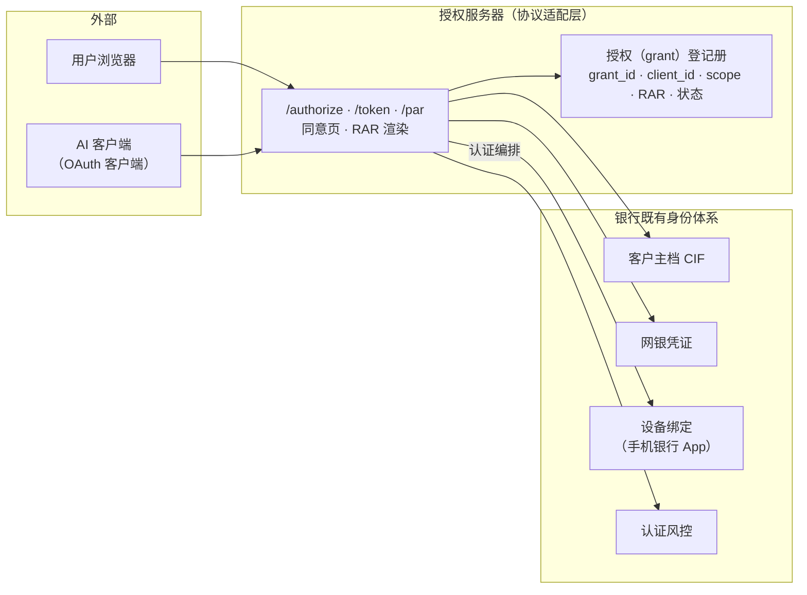
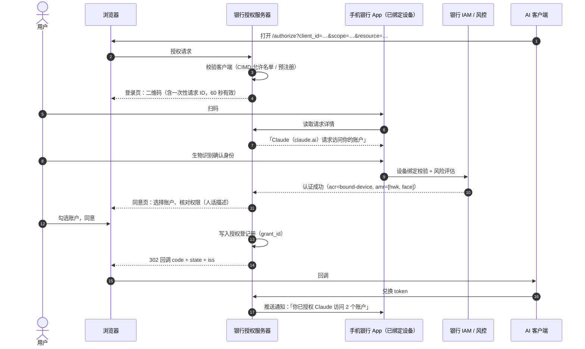
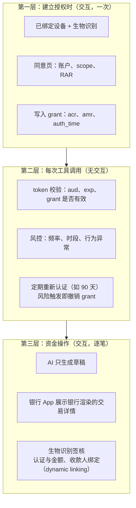

# 第 4 篇｜AuthN（下）：绑定银行现有身份体系，SCA 放在哪一步

> 系列：《让 AI 替你办银行业务：面向 MCP Connector 的身份认证与授权设计》
> 规范基线：MCP `2026-07-28`；OpenID Connect Core 1.0；OpenID Connect CIBA Core 1.0；RFC 9470；HKMA「E-Banking Security ABC」（2025-04）
> 撰写日期：2026-10-23

---

## 0. 两个身份问题

AI connector 里有两个容易混在一起的身份问题：

1. **谁在授权？** 用户点「连接」后，在银行页面上完成登录和同意的那个人，是不是账户的主人？
2. **谁在操作？** 之后每一次工具调用，背后是用户、是 AI，还是被注入操纵的 AI？

第一个问题靠**认证**回答，发生在授权建立时；第二个问题认证回答不了——token 只能证明「这个调用来自持有授权的客户端」，证明不了「用户此刻想做这件事」。所以对资金操作，我们需要第三层：**交易时由用户本人在受信设备上签核**。

本篇讲清楚三件事：授权服务器如何接入银行现有身份体系；认证时用什么方式（结合香港监管）；强客户认证（SCA）分别放在哪三层。

---

## 1. 授权服务器是协议适配层，不是新账号体系

银行最不应该做的事，是为 AI 渠道新建一套用户名和密码。正确的定位是：**OAuth 授权服务器是现有 IAM 前面的一层协议适配**。用户身份、凭证、设备绑定、风控，全部复用。



几个落地要点：

- **认证编排复用 App 的设备绑定。** 用户在授权页上不应该输入网银密码再收短信验证码，而是用已绑定设备上的手机银行 App 确认（见第 2 节）。
- **授权登记册（grant registry）是新增的核心组件。** 它记录每一次 AI 授权：哪个用户、哪个客户端、什么 scope 和 RAR、何时建立、用了什么认证方式、当前是否有效。审计（第 11 篇）、撤销与授权管理中心（第 8 篇）都以 `grant_id` 为主键。
- **AI 客户端只需要 access token，不需要知道用户是谁。** 不要默认给 AI 客户端签发带姓名、手机号的 ID Token，也不要开放 userinfo。工具需要的用户信息（如账户展示名）由 MCP server 按需返回并做脱敏。

### 1.1 `sub` 用成对假名

access token 的 `sub` 不应该是 CIF 客户号。建议使用 OIDC Core 定义的**成对（pairwise）标识符**：同一用户在不同客户端（例如 Claude 与另一家 AI 平台）下得到不同的 `sub`。

- AI 平台之间无法通过 `sub` 关联同一用户；
- 某一个 AI 平台的日志泄露时，泄露的不是客户号；
- 银行内部通过映射表把 `sub` 还原成 CIF，供 MCP server 调内部 API 使用（经由第 6 篇的 Token Exchange，内部 token 里可以携带 CIF）。

---

## 2. 授权时用什么方式认证

### 2.1 香港的监管基线

HKMA 2025 年 4 月「E-Banking Security ABC」通函附件中的第一项「Authenticate in-App」要求：对拥有手机银行 App 的客户，**网上银行登录与高风险交易默认通过已绑定设备认证，而不是短信 OTP**（实施时间 2025 年第四季度）；客户要求更改这一默认方式，本身也被视为高风险交易，不得用短信 OTP 认证。在确有需要继续使用短信 OTP 的场景，银行应对高风险交易实施「冷静期」并加强监控。此外，新设备绑定与重新绑定应使用人脸识别（与银行记录或身份证件比对）或同等严格的方式，而不是短信 OTP。

AI 授权页本质上是一次网上银行登录，加上一次「把账户访问权交给第三方平台」的决定。笔者的建议是：**把「建立或扩大 AI 授权」视同高风险操作，一律通过已绑定设备认证，不提供短信 OTP 路径。** 这比监管基线更严格，但理由充分：一旦授权建立，后续访问不再有用户交互。

### 2.2 四种认证方式对比

| 方式 | 流程 | 优点 | 风险与注意 |
|---|---|---|---|
| 网页密码 + 短信 OTP | 浏览器内输入 | 实现简单 | 不符合上述监管方向；易被钓鱼 |
| **扫码确认** | 授权页显示二维码，用户用 App 扫码，生物识别确认 | 桌面端体验好；凭证不经浏览器 | 二维码可被转发到钓鱼页面，需要短时效并在 App 内显示请求来源 |
| **App-to-App** | 移动端浏览器通过 Universal Link／App Link 拉起银行 App，确认后返回 | 移动端最顺滑 | 需确认 AI 客户端在移动端打开授权页的方式；返回时回到 `claude.ai` 回调地址 |
| 推送确认（解耦） | 授权页让用户输入标识，银行向已绑定设备推送 | 无需扫码 | **推送疲劳**攻击：攻击者反复发起请求赌用户误点；必须配合号码匹配或在 App 内展示完整请求内容 |

推荐组合：**桌面端扫码、移动端 App-to-App，推送仅作为后备并要求号码匹配。**

### 2.3 连接时序



最后一步常被忽略：**授权建立后立即通过 App 推送通知用户**。如果授权不是用户本人发起的，这是用户最早能发现的时机。

### 2.4 同意页不能因为「已登录」而跳过

很多银行的 OIDC Provider 在用户已有登录会话时会静默授权。对 AI 客户端，这正是 MCP 安全最佳实践中混淆代理攻击的成因之一：攻击者构造授权链接，借用户已有的会话和同意记录，把授权码送到攻击者控制的地方。规则很简单：

- **每一次 AI 客户端授权都必须展示同意页**，不论是否已有会话；
- 同意记录按 `client_id` 绑定，新客户端、新 scope、新 RAR 都要重新同意；
- 同意页显示回调地址的主机名，禁止被嵌入 iframe（`frame-ancestors 'none'`）。

---

## 3. 三层 SCA



### 3.1 第一层：建立授权时

这一层回答「是不是账户主人在授权」。要求已在第 2 节讨论。需要特别记录的是**认证上下文**：`acr`（认证强度等级）、`amr`（认证方法）、`auth_time`（认证时间）。它们写入授权登记册，也写入 access token，MCP server 可以据此做判断——例如要求起草权限只能来自 `acr=bound-device` 的授权。

### 3.2 第二层：每次工具调用

这一层没有用户交互，靠的是：

- **短期 access token 与 refresh token 轮换**（第 8 篇）；
- **授权有效性实时检查**：MCP server 每次请求都检查 `grant_id` 是否已撤销（示例 `isGrantActive`）；
- **风控**：AI 渠道调用频率、查询模式是否异常（例如几分钟内遍历所有账户的全部流水）；
- **定期重新认证**：授权超过一定时长后，要求用户重新走一次第一层。

香港没有像欧盟 PSD2 那样对「账户信息访问多久需要重新做 SCA」作出具体规定。可以参考欧盟的做法：PSD2 SCA 监管技术标准（Delegated Regulation (EU) 2018/389）经 2022/2360 修订后，对通过第三方的账户信息访问，规定最长 180 天重新进行 SCA。银行可以据此结合自身风险偏好设定。示例策略（[`token_policy.py`](../code/authz-server/token_policy.py)）对只读授权取 90 天，对包含起草权限的授权取 30 天，与 RAR 的 `valid_until` 对齐。

### 3.3 第三层：资金操作

这一层回答「用户此刻是不是真的想做这笔交易」。OAuth 授权回答不了这个问题：哪怕 token 范围再窄，也只说明用户**曾经**同意 AI 在某个范围内起草。

所以资金操作的确认**不走 OAuth**，而是银行自己的交易签核：

- AI 调用 `create_payment_draft`，银行生成草稿并推送到已绑定设备；
- App 展示的是**银行从草稿记录渲染的字段**——收款人（银行登记的名称）、金额、扣款账户——而不是 AI 生成的任何文字；
- 用户生物识别签核，签核凭证与金额、收款人绑定（**dynamic linking**，概念来自 PSD2 RTS 第 5 条：认证码须针对特定金额与收款人生成，任何一项改变都使认证码失效）；
- 这正符合 HKMA「高风险交易默认通过已绑定设备认证」的要求。

细节在第 9 篇展开。

---

## 4. 两种不同的「step-up」

讨论 AI connector 时，「step-up」一词经常被混用，实际上有两种完全不同的机制：

| | 授权提升（scope step-up） | 交易签核（transaction signing） |
|---|---|---|
| 触发 | MCP server 返回 `403 insufficient_scope` | AI 调用 L2 工具生成草稿 |
| 标准 | MCP `2026-07-28` Scope Challenge Handling；RFC 6750 | 银行自有流程（可借鉴 CIBA、dynamic linking） |
| 用户动作 | 重新走一次 OAuth 授权，同意更多权限 | 在 App 内对**这一笔**交易签核 |
| 结果 | 新的 access token，范围更大 | 这一笔交易被执行；token 不变 |
| 频率 | 偶尔 | 每笔资金操作 |

还有第三种机制值得了解：**RFC 9470 OAuth 2.0 Step-Up Authentication Challenge Protocol**。资源服务器返回 `error="insufficient_user_authentication"`，并在 `WWW-Authenticate` 中附上要求的 `acr_values` 或 `max_age`，让客户端带着这些参数重新授权，从而获得认证强度更高或更新近的 token。

它适合「用户认证太久了，访问敏感数据前要重新认证」的场景。但要注意：**MCP `2026-07-28` 没有规定客户端必须支持 RFC 9470**，撰写时 Claude 的 connector 文档也未提及。银行可以在 MCP server 上实现它，但必须准备好客户端不理解时的降级方案——例如改为返回 `invalid_token`，迫使客户端走完整的重新授权，或者把要求写进 RAR 的有效期。

---

## 5. 几个特殊身份场景

**联名账户。** 一方授权 AI 访问联名账户，是否需要另一方知情？各行做法不同。建议：只读授权可由任一方作出，但在另一方的 App 中显示该授权；起草权限要求按账户本身的签核规则（「任一人签」或「双方签」）在第三层落实。

**未成年人与受监护账户。** 默认不向 AI 渠道开放。

**对公操作员。** 第 2 篇讨论过 Enterprise Managed Auth（企业 IdP 断言换 token）。对银行对公业务的建议是：企业 IdP 断言只能证明「此人是 X 公司员工」，**不能替代银行对操作员的强认证**。可行的做法是：企业 IdP 断言用于识别操作员身份并免去重复登录，但授权服务器仍要求操作员用银行发放的认证工具（对公 App 或硬件令牌）完成一次认证后才签发 token；资金类草稿的制单确认仍在银行侧完成。注意 Claude 文档特别说明，Enterprise Managed Auth 不支持 DCR，客户端须预注册或使用 CIMD。

**代理人与授权书。** 持有授权书的代理人通过 AI 访问委托人账户，应按代理关系本身的权限范围签发，并在 token 中区分 `sub`（代理人）与被访问账户的所有人。

---

## 6. access token 里放什么

示例银行的 access token（RFC 9068 JWT 格式）：

```json
{
  "iss": "https://auth.examplebank.hk",
  "sub": "pw_4f9c1e…",
  "aud": "https://mcp.examplebank.hk/mcp",
  "client_id": "examplebank-claude-hosted",
  "scope": "accounts:read transactions:read payments:draft",
  "grant_id": "grt_8Kd2…",
  "acr": "urn:examplebank:acr:bound-device",
  "amr": ["hwk", "face"],
  "auth_time": 1792740000,
  "authorization_details": [{ "type": "https://examplebank.hk/rar/payment-draft/v1", "…": "…" }],
  "iat": 1792740100,
  "exp": 1792740400,
  "jti": "…"
}
```

**不放**：姓名、电话、客户号、真实账号。它们一旦写进 token，就会出现在 AI 平台的存储里。

---

## 给银行的设计决策清单

1. **授权服务器作为既有 IAM 的协议适配层**，新增「授权登记册」组件，所有 AI 授权以 `grant_id` 为主键管理；`sub` 用成对假名，token 中不放任何可识别个人的资料。
2. **建立或扩大 AI 授权一律通过已绑定设备认证**（桌面扫码、移动端 App-to-App），不提供短信 OTP 路径；授权完成后立即在 App 推送通知。
3. **AI 客户端的每一次授权都展示同意页**，不因已有登录会话而跳过；同意按 `client_id` 与权限内容绑定。
4. **把 SCA 分三层落实**：建立授权时强认证；调用时靠短 token、实时撤销检查与风控，并设定重新认证周期（建议只读 ≤ 90 天、含起草权限 ≤ 30 天）；资金操作逐笔在 App 内签核并做 dynamic linking。
5. **对公场景不以企业 IdP 断言替代银行对操作员的强认证**，企业 IdP 最多用于免去重复登录。

---

## 参考资料

- HKMA, *New Anti-Digital Fraud Measures: "E-Banking Security ABC"*（附件，2025-04-11）. <https://brdr.hkma.gov.hk/gb_chi/doc-ldg/docId/getPdf/20250411-3-EN/20250411-3-EN.pdf>
- OpenID Foundation, *OpenID Connect Core 1.0*（§8 Subject Identifier Types：pairwise）.
- OpenID Foundation, *OpenID Connect Client-Initiated Backchannel Authentication Flow – Core 1.0*.
- IETF, RFC 9068 *JWT Profile for OAuth 2.0 Access Tokens*；RFC 9470 *OAuth 2.0 Step-Up Authentication Challenge Protocol*.
- European Commission, Delegated Regulation (EU) 2018/389（RTS on SCA and CSC），及修订 Delegated Regulation (EU) 2022/2360.
- MCP, *Security Best Practices — Confused Deputy Problem*（2026-07-28）. <https://modelcontextprotocol.io/docs/2026-07-28/tutorials/security/security_best_practices>
- Anthropic, *Enterprise Managed Auth for connectors*. <https://claude.com/docs/connectors/building/enterprise-managed-auth>
