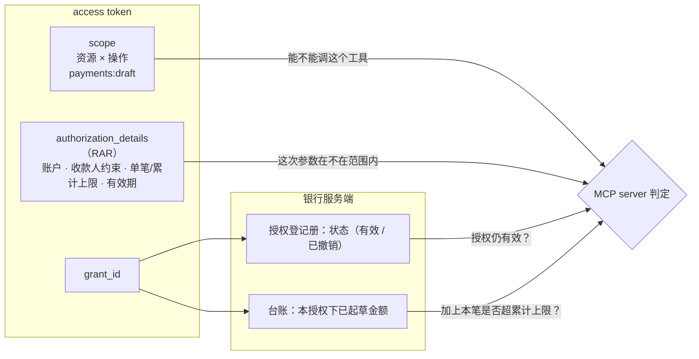
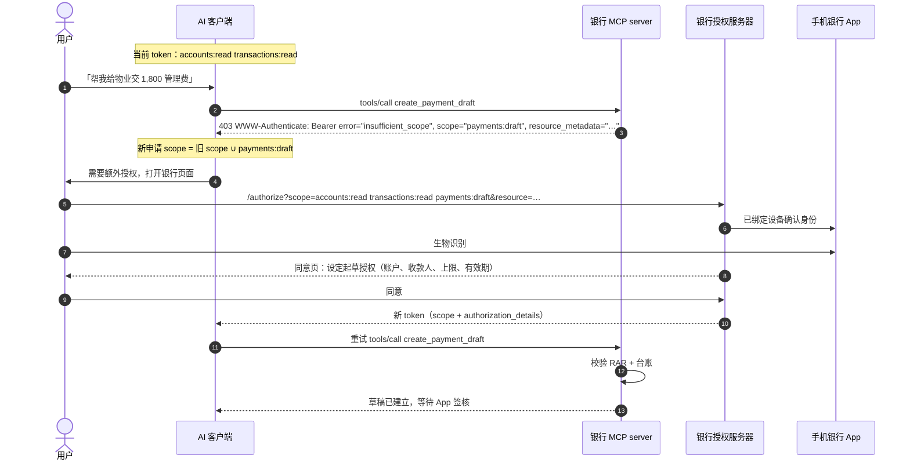

# 第 5 篇｜AuthZ（一）：权限模型——从 scope 到 Rich Authorization Requests

> 系列：《让 AI 替你办银行业务：面向 MCP Connector 的身份认证与授权设计》
> 规范基线：MCP `2026-07-28`（Scope Selection Strategy、Scope Challenge Handling）；RFC 6749 §3.3；RFC 6750 §3.1；RFC 9396
> 撰写日期：2026-10-23

---

## 0. 一句话授权

用户对 AI 说：「以后每个月帮我给物业交管理费，从储蓄户扣，每次不超过 2,000 港元。」

翻译成授权，至少包含五个维度：

| 维度 | 这句话里的值 |
|---|---|
| 资源 | 支付 |
| 操作 | 起草（不是执行，见第 2 篇） |
| 账户 | 储蓄户 `acc_7Hq2` |
| 金额上限 | 每笔 HK$2,000 |
| 有效期 | 若干个月（银行政策可能再收紧） |

还隐含第六个维度：**收款人**——只限物业管理处。

本篇讨论这些维度应该分别放在哪里：哪些进 scope，哪些进 Rich Authorization Requests（RAR，RFC 9396），哪些留在服务端台账里。

---

## 1. scope 擅长什么、不擅长什么

RFC 6749 §3.3 对 scope 的定义很朴素：一个以空格分隔、大小写敏感的字符串列表，含义由授权服务器定义。它**没有结构**。

把五个维度都塞进 scope，会得到这样的东西：

```text
payments:draft:acc_7Hq2:payee=pay_Cd34:max=2000HKD:until=2026-12-31
```

问题很明显：

- **组合爆炸**：账户数 × 收款人数 × 金额档位 × 有效期，没法事先在 `scopes_supported` 里列举；
- **语义不可校验**：授权服务器和资源服务器都得自己解析这串字符，任何一方解析不一致就是漏洞；
- **同意页难以渲染**：用户看到的要么是这串字符，要么是各方各自翻译的文案；
- **违背 MCP 的增量授权设计**：MCP 规定客户端在增量授权时，要把之前申请过的 scope 与新挑战的 scope 取并集。动态 scope 会让这个并集越滚越大。

所以分工是：

- **scope** 只表达「资源 × 操作」，是一个**粗粒度、可枚举、可在 `scopes_supported` 公布**的词表；
- **RAR** 表达账户、收款人、金额、有效期等**结构化约束**；
- **服务端台账**记录**消耗**（例如本授权下已经起草了多少钱）——token 只能表达上限，表达不了用了多少。



---

## 2. ExampleBank 的 scope 词表

| scope | 等级 | 对应工具 | 说明 |
|---|---|---|---|
| `accounts:read` | L0 | `list_accounts` | **基础集**，出现在 401 挑战与 `scopes_supported` |
| `transactions:read` | L0 | `list_transactions` | **基础集** |
| `cards:read` | L0 | `list_cards`（示例代码未实现） | |
| `alerts:write` | L1 | `create_alert`（示例代码未实现） | 只能新增，不能删除（第 2 篇） |
| `budgets:write` | L1 | `set_budget`（示例代码未实现） | |
| `cards:freeze` | L1 | `freeze_card` | 只有冻结，没有解冻 |
| `payments:draft` | L2 | `create_payment_draft` 等 | **必须伴随 RAR** |

设计原则：

1. **没有通配符，没有 `*:execute`。** 词表里刻意不存在 `payments:write`、`cards:unfreeze`、`banking:full`。这不是「暂时没做」，而是写进设计文档的「不做」。
2. **命名 `资源:操作`，操作用业务动词**（`draft`、`freeze`），而不是 CRUD（`write`、`delete`）。CRUD 动词会诱导对称设计。
3. **基础集只含 L0。** 回顾第 3 篇：401 未给出 `scope` 时，客户端会申请 `scopes_supported` 中的全部 scope。MCP 安全最佳实践也把「在 `scopes_supported` 中公布所有可能的 scope」列为常见错误。
4. **如果引入层级 scope，服务端必须处理蕴含关系。** MCP 规定服务端判断 token 是否足够时 MUST 考虑 scope 层级。ExampleBank 不引入层级，判断就是简单的包含关系（`hasScope`）。

**账户选择放在哪？** 用户在同意页上勾选「允许 AI 访问哪些账户」。这个选择**存入授权登记册**，而不是写进外部 token：

- 外部 token 只有 `grant_id`；
- MCP server 通过 Token Exchange（第 6 篇）换取内部 token 时，内部 STS 根据 `grant_id` 把可访问账户写进内部 token；
- 内部 API 据此过滤。

这样做的好处是：账户清单不出现在 AI 平台保存的 token 里；用户在 App 中取消某个账户的授权，下一次 Token Exchange 立即生效，无需等外部 token 过期。

---

## 3. RAR：RFC 9396 速览

RFC 9396 在 OAuth 授权请求中引入 `authorization_details` 参数：一个 JSON 数组，每个元素是一个对象，必须有 `type` 字段，其余字段由该 type 定义。RFC 还定义了几个通用字段：

| 字段 | 含义 |
|---|---|
| `type` | 授权详情类型（必填） |
| `locations` | 可以在哪些资源服务器上使用 |
| `actions` | 允许的动作 |
| `datatypes` | 可访问的数据类型 |
| `identifier` | 具体资源的标识 |
| `privileges` | 权限级别 |

授权服务器在元数据中用 `authorization_details_types_supported` 声明支持哪些类型；token 响应会把**最终授予的** `authorization_details` 返回给客户端，JWT access token 中也可以携带同名 claim。

### 3.1 ExampleBank 的支付草稿类型

```json
{
  "type": "https://examplebank.hk/rar/payment-draft/v1",
  "actions": ["create_draft"],
  "locations": ["https://mcp.examplebank.hk/mcp"],
  "debtor_account_ref": "acc_7Hq2",
  "creditor_constraint": { "mode": "listed", "payee_refs": ["pay_Cd34"] },
  "instructed_amount_limit": {
    "currency": "HKD",
    "per_transaction": "2000.00",
    "cumulative": "6000.00"
  },
  "valid_until": "2026-11-22T00:00:00Z"
}
```

设计要点：

- **`type` 用银行域名下的 URI 并带版本号**，日后修改结构时新增 `/v2`，不改旧类型的语义；
- **`actions` 只有 `create_draft`**。授权服务器收到包含任何执行类动作的申请，**直接拒绝**，而不是悄悄删掉——悄悄删掉会让客户端误以为拿到了执行权；
- **`locations` 与 RFC 8707 的 `resource` 一致**，确保这条授权只能在银行 MCP server 上使用；
- **金额用十进制字符串**，不用浮点数；
- **收款人只用银行内部引用**（`pay_Cd34`），不出现真实账号。

### 3.2 JSON Schema

```json
{
  "$schema": "https://json-schema.org/draft/2020-12/schema",
  "$id": "https://examplebank.hk/rar/payment-draft/v1/schema.json",
  "type": "object",
  "required": ["type", "actions", "locations", "debtor_account_ref", "creditor_constraint", "instructed_amount_limit", "valid_until"],
  "additionalProperties": false,
  "properties": {
    "type": { "const": "https://examplebank.hk/rar/payment-draft/v1" },
    "actions": { "type": "array", "items": { "const": "create_draft" }, "minItems": 1, "maxItems": 1 },
    "locations": { "type": "array", "items": { "type": "string", "format": "uri" }, "minItems": 1 },
    "debtor_account_ref": { "type": "string", "pattern": "^acc_[A-Za-z0-9]{4,32}$" },
    "creditor_constraint": {
      "oneOf": [
        { "type": "object", "required": ["mode"], "additionalProperties": false,
          "properties": { "mode": { "const": "registered_payees_only" } } },
        { "type": "object", "required": ["mode", "payee_refs"], "additionalProperties": false,
          "properties": { "mode": { "const": "listed" },
                          "payee_refs": { "type": "array", "items": { "type": "string", "pattern": "^pay_[A-Za-z0-9]{4,32}$" }, "minItems": 1, "maxItems": 10 } } }
      ]
    },
    "instructed_amount_limit": {
      "type": "object", "required": ["currency", "per_transaction", "cumulative"], "additionalProperties": false,
      "properties": {
        "currency": { "const": "HKD" },
        "per_transaction": { "type": "string", "pattern": "^\\d{1,12}(\\.\\d{1,2})?$" },
        "cumulative": { "type": "string", "pattern": "^\\d{1,12}(\\.\\d{1,2})?$" }
      }
    },
    "valid_until": { "type": "string", "format": "date-time" }
  }
}
```

---

## 4. 现实问题：谁来构造 RAR？

RFC 9396 的设想是**客户端**在授权请求中带上 `authorization_details`。但 Claude 这样的通用 MCP 客户端不认识银行的私有 RAR 类型，MCP 规范也只定义了基于 scope 的挑战与增量授权。撰写时，Claude 的 connector 文档只描述了 scope 的处理方式，没有提及 `authorization_details`。

所以对通用 AI 客户端，银行需要换个思路：**由授权服务器在同意环节生成 RAR。**

| 方式 | 流程 | 适用 |
|---|---|---|
| **A. AS 侧展开（推荐）** | 客户端只申请 `payments:draft`；AS 的同意页让用户设定扣款账户、收款人、上限、有效期，生成 `authorization_details` 写入 grant 和 token | 通用 AI 客户端 |
| B. 客户端发送 RAR | 客户端通过 PAR 提交 `authorization_details` | 认识银行 RAR 类型的定制客户端 |
| C. 带外配置 | MCP server 通过 URL 模式 elicitation 把用户引到银行页面配置授权，结果只存服务端 | 需要在不重新授权的情况下调整额度 |

方式 A 的本质是：scope 是客户端能理解的「申请」，RAR 是银行和用户协商出的「批准」。客户端不需要理解 RAR，只需原样携带 token。

---

## 5. 增量授权：从只读到起草



几个规范细节：

- MCP 规定服务端 SHOULD 在**一次挑战中给出当前操作需要的全部 scope**，避免多轮往返；
- 增量授权时，客户端 SHOULD 把之前申请的 scope 与新挑战的 scope 取并集，否则会丢失原有权限；
- 客户端 SHOULD 限制重试次数，避免授权循环。

示例代码用 SDK 的 `requireScopes` 声明每个工具需要的 scope：

```ts
server.registerTool(
  'create_payment_draft',
  { /* … */ scopeChallenge: requireScopes(Scope.PaymentsDraft) },
  async (args, ctx) => { /* … */ },
);
```

本地测试中，用只读 token 调用 `create_payment_draft`，`@modelcontextprotocol/server` 2.3.1 返回：

```text
HTTP/1.1 403 Forbidden
www-authenticate: Bearer error="insufficient_scope", error_description="Insufficient scope", scope="payments:draft", resource_metadata="http://127.0.0.1:8080/.well-known/oauth-protected-resource/mcp"
```

---

## 6. 同意页：用人话写清楚 AI 不能做什么

同意页是用户唯一一次看清授权内容的机会。原则：

1. **先说 AI 不能做什么**——「不能自行付款」应出现在第一行；
2. **每个 RAR 字段都翻译成具体文字**：哪个账户、哪些收款人、每笔多少、合共多少、到什么时候；
3. **给出撤销路径**；
4. **银行政策对申请进行收紧**，同意页展示的是收紧后的结果。

参考实现 [`code/authz-server/rar_consent.py`](../code/authz-server/rar_consent.py) 对申请做政策收紧（单笔 ≤ HK$10,000、累计 ≤ HK$30,000、有效期 ≤ 30 天、拒绝任何执行类动作），并生成繁体中文同意文案：

```text
允許 AI 助手為你「起草」轉賬，但不能自行付款：
・扣款賬戶：港元儲蓄 ***381
・收款人：只限已登記收款人
・每筆上限 HK$10,000.00，合共上限 HK$30,000.00
・有效至 2026年11月22日 08:00（香港時間）
每一筆轉賬仍需你在示例銀行 App 內核對並驗證後才會執行。你可隨時在 App 的「AI 授權管理」中取消。
```

---

## 7. 服务端复核：token 是上限，台账是消耗

MCP server 收到 `create_payment_draft` 时，按以下顺序判定（[`code/mcp-server/src/auth/rar.ts`](../code/mcp-server/src/auth/rar.ts)）：

```ts
for (const d of details as PaymentDraftAuthorization[]) {
  if (d?.type !== PAYMENT_DRAFT_TYPE) continue;
  if (!d.actions?.includes('create_draft')) continue;
  if (!d.locations?.includes(resourceUrl)) continue;
  if (new Date(d.valid_until) <= now) continue;
  if (d.debtor_account_ref !== req.debtorAccountRef) continue;
  if (d.instructed_amount_limit.currency !== req.currency) continue;

  const c = d.creditor_constraint;
  const payeeOk =
    c.mode === 'registered_payees_only' ? req.payeeIsRegistered : c.payee_refs.includes(req.payeeRef);
  if (!payeeOk) continue;

  const amount = toMinorUnits(req.amount);
  if (amount > toMinorUnits(d.instructed_amount_limit.per_transaction)) continue;
  if (draftedSoFarMinor + amount > toMinorUnits(d.instructed_amount_limit.cumulative)) continue;

  return { ok: true, grant: d };
}
```

注意三点：

- **收款人是否「已登记」以银行实时查询为准**（`findPayee`），不信任客户端传入；
- **累计额度查服务端台账**（`draftedTotalMinor`），被拒绝、撤回、过期的草稿不计入；
- **金额转成最小货币单位的整数比较**，避免浮点误差。

本地测试（RAR：单笔 ≤ HK$5,000，累计 ≤ HK$8,000）：

| 请求 | 结果 |
|---|---|
| 6,000 | 拒绝：超出单笔上限 |
| 3,000 | 草稿建立 |
| 6,000（累计 9,000） | 拒绝：超出累计上限 |
| 1,000（累计 4,000） | 草稿建立 |

---

## 8. 用户会缩小授权，服务端要接受

用户可能在同意页上只勾选一部分账户，或把单笔上限调低；授权服务器也可能只授予申请 scope 的子集。MCP 安全最佳实践把这称为「down-scoping tolerance」：服务端要接受范围比申请更小的 token，并在超出范围时返回清晰的错误，引导用户到 App 调整，而不是反复触发增量授权。

---

## 9. 更多 RAR 类型：外汇与理财

同一套方法可以扩展到其他 L2 场景。每个类型只表达**这类业务真正需要约束的维度**。

**外汇草稿**：

```json
{
  "type": "https://examplebank.hk/rar/fx-draft/v1",
  "actions": ["create_draft"],
  "locations": ["https://mcp.examplebank.hk/mcp"],
  "debtor_account_ref": "acc_7Hq2",
  "creditor_account_ref": "acc_Usd8",
  "currency_pairs": ["HKD/USD"],
  "sell_amount_limit": { "currency": "HKD", "per_transaction": "20000.00", "cumulative": "50000.00" },
  "valid_until": "2026-11-22T00:00:00Z"
}
```

外汇只允许在**用户本人名下的账户之间**换汇，所以用 `creditor_account_ref` 指定入账账户，而不是收款人约束。报价本身不进 RAR：报价有效期以秒计，属于草稿，而不是授权。

**理财申购草稿**：

```json
{
  "type": "https://examplebank.hk/rar/investment-subscription-draft/v1",
  "actions": ["create_draft"],
  "locations": ["https://mcp.examplebank.hk/mcp"],
  "settlement_account_ref": "acc_7Hq2",
  "product_constraint": { "max_risk_rating": 3, "product_types": ["unit_trust"] },
  "amount_limit": { "currency": "HKD", "per_transaction": "50000.00", "cumulative": "100000.00" },
  "valid_until": "2026-11-22T00:00:00Z"
}
```

`max_risk_rating` 让授权本身就排除了超出客户风险承受等级的产品。它不能替代签核时的适当性评估（第 9 篇），但能让 AI 根本起草不出明显不合适的申购单。

---

## 10. 版本管理与同意文案

RAR 和 scope 词表都是**对外契约**，一旦签发出去的 token 里带着它，就不能随意改变语义：

- **类型 URI 带版本号**。新增字段走 `/v2`，旧类型继续按原语义校验，直到所有带旧类型的 grant 过期；
- **同意文案也要版本化**。授权登记册中记录用户同意时看到的文案版本（第 8 篇的 grant 数据模型），出现争议时可以还原「用户当时看到的是什么」；
- **scope 语义不能悄悄变宽**。MCP 安全最佳实践把「不经版本管理就改变 scope 语义」列为常见错误。例如给 `cards:freeze` 增加「同时冻结关联的附属卡」，就应该是一个新 scope，而不是修改旧 scope 的含义。

---

## 11. 常见错误

| 错误 | 后果 | 正确做法 |
|---|---|---|
| RAR 中出现 `execute` 动作 | AI 渠道获得了执行权 | AS 直接拒绝，而不是删掉后继续 |
| 在 RAR 中写真实账号 | 账号出现在 AI 平台保存的 token 里 | 只用不透明引用 |
| 只在 token 中表达累计额度 | 服务端无法知道已经用了多少 | 台账记录消耗，token 只表达上限 |
| 信任客户端传入的「收款人已登记」 | 注入可以伪造该标记 | 服务端实时查询 |
| scope 与 RAR 冗余表达同一约束 | 两者不一致时不知以谁为准 | scope 管「能不能调用」，RAR 管「参数范围」 |
| 同意页只显示 scope 名称 | 用户看不懂，等于没有同意 | 用同一个文案生成器生成同意页与授权管理中心的描述 |

---

## 给银行的设计决策清单

1. **scope 只表达「资源 × 操作」**，用业务动词命名，词表中不存在任何执行类 scope 和通配符；`scopes_supported` 只公布 L0 基础集。
2. **账户、收款人、金额、有效期用 RAR 表达**，为每个 RAR 类型发布带版本号的 JSON Schema，并在 AS 元数据中声明 `authorization_details_types_supported`。
3. **对通用 AI 客户端采用「AS 侧展开」**：客户端只申请 scope，由同意页与用户协商生成 RAR；授权服务器按银行政策收紧申请，拒绝任何执行类动作。
4. **服务端每次复核 RAR，并用台账计算累计消耗**；收款人登记状态、账户归属以银行实时数据为准。
5. **可访问账户清单存授权登记册，不写入外部 token**，经 Token Exchange 传给内部 API，用户在 App 中修改后即时生效。

---

## 参考资料

- IETF, RFC 9396 *OAuth 2.0 Rich Authorization Requests*.
- IETF, RFC 6749 §3.3（Access Token Scope）；RFC 6750 §3.1（Error Codes：`insufficient_scope`）.
- Model Context Protocol Specification `2026-07-28`, *Authorization — Scope Selection Strategy / Scope Challenge Handling*. <https://modelcontextprotocol.io/specification/2026-07-28/basic/authorization>
- MCP, *Security Best Practices — Scope Minimization*（2026-07-28）. <https://modelcontextprotocol.io/docs/2026-07-28/tutorials/security/security_best_practices>
- Anthropic, *Authentication for connectors — PKCE and requested scopes*. <https://claude.com/docs/connectors/building/authentication>
- 示例代码：[`rar.ts`](../code/mcp-server/src/auth/rar.ts)、[`scopes.ts`](../code/mcp-server/src/auth/scopes.ts)、[`rar_consent.py`](../code/authz-server/rar_consent.py)
