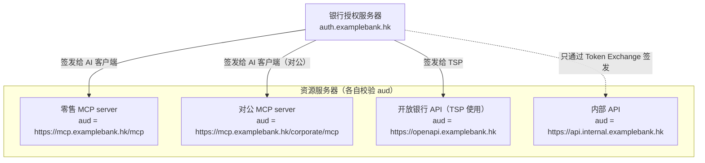
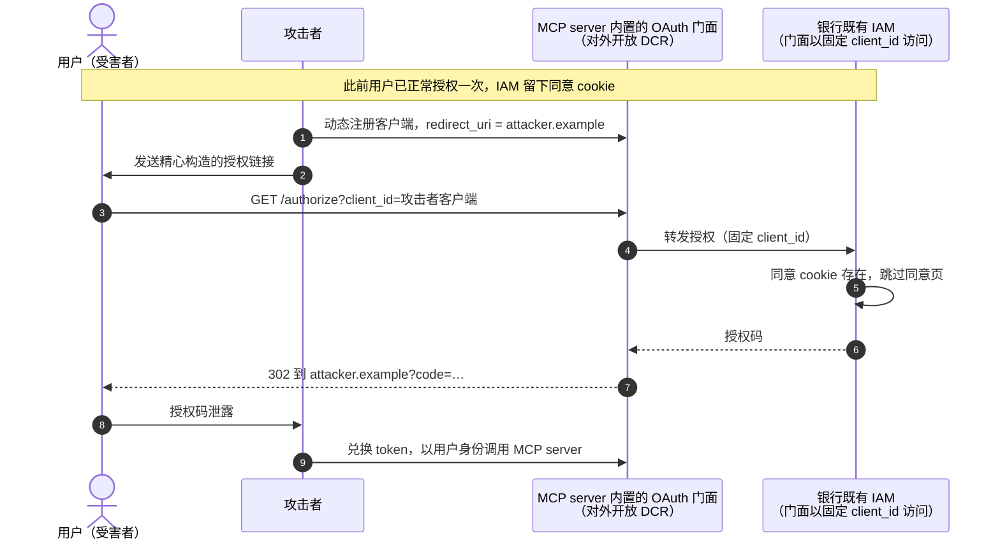
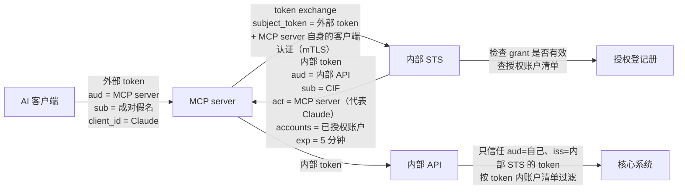

# 第 6 篇｜AuthZ（二）：受众绑定——token passthrough 与混淆代理

> 系列：《让 AI 替你办银行业务：面向 MCP Connector 的身份认证与授权设计》
> 规范基线：MCP `2026-07-28`（Authorization、Security Considerations、Security Best Practices）；RFC 8707；RFC 8693；RFC 9068
> 撰写日期：2026-10-23

---

## 0. 一枚 token 可能被怎样误用

银行授权服务器签发给 Claude 的 access token，本意是「只能拿来调用示例银行的 MCP server，且只能做这些事」。现实中，它可能在三个地方越界：

1. **被拿去调用别的资源服务器。** 例如银行既有的 Open API，或者另一个也信任同一授权服务器的内部服务。
2. **被 MCP server 原样转发给下游。** MCP server 图省事，把收到的 token 直接塞进调用内部 API 的请求头——这就是 MCP 规范明令禁止的 **token passthrough**。
3. **被一个「代理型」MCP server 借用身份。** MCP server 用一个固定的客户端身份去访问另一个授权服务器，攻击者借助用户已有的同意记录，绕过同意页拿到授权——这就是**混淆代理（confused deputy）**。

这三种越界有一个共同点：**token（或授权）离开了它本应停留的边界。** 本篇逐一拆解，并给出银行的标准做法：RFC 8707 受众绑定 + RFC 8693 Token Exchange 内外隔离。

---

## 1. 受众绑定：RFC 8707 Resource Indicators

### 1.1 机制

RFC 8707 在授权请求和 token 请求中引入 `resource` 参数，客户端用它声明「这枚 token 我打算拿去用在哪里」。授权服务器据此把 token 的 `aud` 设为该资源，资源服务器校验 `aud` 是否是自己。

MCP `2026-07-28` 对三方都有硬性要求：

- **客户端** MUST 在授权请求和 token 请求中都带上 `resource`，值为 MCP server 的规范 URI，**无论授权服务器是否支持**；
- **MCP server** MUST 校验 token 是专门签发给自己的（audience），MUST 拒绝 `aud` 中不包含自己的 token；
- **客户端** MUST NOT 把不是由该 MCP server 的授权服务器签发的 token 发给它。

### 1.2 银行的多资源现实

一家银行的授权服务器往往同时服务好几类资源：



授权服务器的策略：

| 规则 | 理由 |
|---|---|
| AI 客户端的 token **只允许一个** `resource`，且必须在白名单中 | 一枚 token 只对应一个资源服务器；多受众 token 会让「被任一受众偷用」的风险叠加 |
| 未知 `resource` 返回 `invalid_target`（RFC 8707 §2） | 防止客户端申请到意外受众的 token |
| AI 客户端**永远不能**申请到内部 API 的受众 | 内部 API 只接受 Token Exchange 签发的 token |
| 开放银行 API 不接受 `aud` 为 MCP server 的 token，反之亦然 | 两个渠道的监管属性、风控模型不同 |

### 1.3 MCP server 的校验

示例实现（[`verifier.ts`](../code/mcp-server/src/auth/verifier.ts)）用 `jose` 校验 RFC 9068 格式的 JWT access token：

```ts
const result = await jwtVerify<BankAccessTokenClaims>(token, jwks, {
  issuer: config.issuer,
  // aud 必须是本 MCP server 的规范 URI —— 这一行就是对 token passthrough / 跨资源复用的第一道防线
  audience: config.resourceUrl.href,
  algorithms: config.allowedAlgs,
  typ: 'at+jwt',
  requiredClaims: ['exp', 'iat', 'sub', 'client_id', 'grant_id'],
  clockTolerance: 30,
});
```

- `typ: 'at+jwt'`：RFC 9068 规定 access token 的 JOSE 头 `typ` 为 `at+jwt`，可以防止把 ID Token 当成 access token 使用；
- `algorithms` 白名单：拒绝 `none`、`HS256` 等不该出现的算法；
- 规范 URI 的写法要统一（第 3 篇已提醒：不要尾部斜杠）。

本地测试中，用 `aud` 为 `https://other.example/api` 的 token 调用 MCP server，返回：

```text
HTTP/1.1 401 Unauthorized
WWW-Authenticate: Bearer error="invalid_token", resource_metadata="…", error_description="token rejected"
```

如果使用不透明 token，可以通过 RFC 7662 内省获得 `aud`，校验逻辑相同。

---

## 2. Token passthrough：为什么明令禁止

### 2.1 反模式长什么样

```ts
// ❌ 反模式：把 AI 客户端给的 token 直接转发给内部 API
app.post('/mcp', async (req, res) => {
  const token = req.headers.authorization; // 来自 AI 客户端
  const accounts = await fetch('https://api.internal.examplebank.hk/accounts', {
    headers: { authorization: token },      // 原样转发
  });
  // …
});
```

这段代码在功能上能工作——只要内部 API 也信任同一个授权服务器、并且没有严格校验 `aud`。也正因为「能工作」，它很容易出现在 PoC 里，再被带进生产。

### 2.2 风险

MCP 安全最佳实践列出了四类风险，放到银行语境里：

| 风险 | 银行语境 |
|---|---|
| **绕过安全控制** | MCP server 上的限流、参数校验、数据脱敏、AI 渠道风控，全部可以被「直接拿 token 调内部 API」绕过 |
| **审计与问责失效** | 内部 API 日志里看到的是一个用户 token，分不清这次调用来自 App、网银还是 AI 渠道 |
| **信任边界破裂** | 内部 API 原本只信任内部调用方，现在等于直接面对互联网上的 AI 平台 |
| **演进困难** | 日后想在 MCP server 上加控制，发现下游早已依赖透传 token |

规范的结论只有一句：MCP server MUST NOT accept or transit any other tokens。如果 MCP server 需要调用上游 API，它要作为那个 API 的 OAuth 客户端，**使用另一枚由上游授权服务器签发的 token**。

---

## 3. 混淆代理：银行最可能踩中的版本

### 3.1 MCP 规范描述的攻击

MCP 安全最佳实践详细描述了一种场景。当以下四个条件**同时**满足时，攻击成立：

1. MCP 代理服务器用一个**固定的 client ID** 访问第三方授权服务器；
2. MCP 代理服务器允许 MCP 客户端**动态注册**（每个客户端拿到自己的 client ID）；
3. 第三方授权服务器在首次授权后设置**同意 cookie**；
4. MCP 代理服务器在转发到第三方授权之前，**没有做按客户端的同意**。

攻击路径：用户曾经正常授权过 → 攻击者动态注册一个回调地址指向自己的客户端 → 诱导用户点击授权链接 → 第三方 AS 看到同意 cookie 直接放行 → 授权码经 MCP 代理被重定向给攻击者。

### 3.2 为什么银行容易踩中

银行既有的 IAM 往往不支持 CIMD、RFC 8707 或 MCP 要求的元数据字段。最省事的方案，是在 MCP server 里**再做一层 OAuth 门面**：对 AI 客户端扮演授权服务器（开放 DCR），对银行既有 IAM 扮演一个固定 client ID 的客户端。

这恰好就是上述四个条件的组合。



### 3.3 解法

**首选：不要做门面。** 把 MCP 所需的能力补到银行授权服务器本身（或采购支持这些能力的产品）：RFC 9728 配套元数据、RFC 8707、CIMD、`iss` 参数。MCP server 只做资源服务器。

**如果暂时只能做门面**，必须满足 MCP 安全最佳实践的全部要求：

- **按客户端的同意**：门面自己维护「用户 × client_id」的已批准登记，**在转发到银行 IAM 之前**展示门面自己的同意页；
- 同意页明确显示客户端名称、所申请的权限、回调地址；防止被嵌入 iframe；
- 同意 cookie 使用 `__Host-` 前缀，`Secure`、`HttpOnly`、`SameSite=Lax`，并绑定具体 `client_id`；
- 回调地址精确匹配；
- `state` 只在用户批准同意之后才写入，一次性使用，短时过期；
- **不开放 DCR**，改用 CIMD 允许名单——这样第 2 个条件就不成立了。

### 3.4 另一种混淆代理：服务账号 + 用户参数

还有一种更隐蔽的混淆代理，与 OAuth 流程无关：

```ts
// ❌ MCP server 用一个权限很大的服务账号调用内部 API，用户身份靠参数传
await internalApi.listAccounts({ serviceToken: SERVICE_ACCOUNT_TOKEN, cif: extra.sub });
```

内部 API 只认服务账号，`cif` 只是参数。只要 MCP server 有一处 bug——比如某个工具的参数里允许传 `cif`，或者在映射时取错了值——AI 就可能读到别人的账户。服务账号就是那个「被混淆的代理」：它有权做任何事，却不知道自己在替谁做。

解法是让**用户身份随凭证一起流动**，而不是随参数流动。这正是 Token Exchange 要做的事。

---

## 4. 内外隔离：RFC 8693 Token Exchange

### 4.1 两层 token



### 4.2 交换请求

```http
POST /token HTTP/1.1
Host: sts.internal.examplebank.hk
Content-Type: application/x-www-form-urlencoded

grant_type=urn:ietf:params:oauth:grant-type:token-exchange
&subject_token=eyJ…（外部 access token）
&subject_token_type=urn:ietf:params:oauth:token-type:access_token
&requested_token_type=urn:ietf:params:oauth:token-type:access_token
&audience=https://api.internal.examplebank.hk
```

MCP server 以**机密客户端**身份向 STS 认证（mTLS 或 `private_key_jwt`）。这一点很关键：STS 由此知道「是 MCP server 在替用户换 token」，而不是任何拿到外部 token 的人都能来换。

STS 的处理：

1. 校验 `subject_token`：签名、`aud` 必须是 MCP server、未过期；
2. 查授权登记册：`grant_id` 是否仍有效；
3. 把成对假名 `sub` 还原为 CIF；
4. 签发内部 token。

### 4.3 内部 token

```json
{
  "iss": "https://sts.internal.examplebank.hk",
  "aud": "https://api.internal.examplebank.hk",
  "sub": "CIF0012345678",
  "act": {
    "sub": "https://mcp.examplebank.hk/mcp",
    "client_id": "examplebank-claude-hosted"
  },
  "channel": "ai_connector",
  "grant_id": "grt_8Kd2…",
  "accounts": ["acc_7Hq2", "acc_9Lm4"],
  "scope": "accounts:read transactions:read",
  "exp": 1792740400
}
```

- **`act`**（RFC 8693 §4.1）记录「谁在代表 `sub` 行事」。内部 API 和审计可以清楚地看到：这是 CIF0012345678 的数据，由 MCP server 代表 Claude 访问。
- **`channel`** 让风控和审计能按渠道区分。
- **`accounts`** 来自授权登记册，用户在 App 里取消某个账户，下一次交换立即生效。
- **scope 只能缩小，不能扩大**：内部 token 的 scope 是外部 token scope 的子集。
- **有效期很短**：示例实现按 `grant_id` 缓存，提前 30 秒刷新。

示例代码见 [`tokenExchange.ts`](../code/mcp-server/src/auth/tokenExchange.ts)。

### 4.4 内部 API 的责任

内部 API 必须：

- 只接受 `iss` 为内部 STS、`aud` 为自己的 token；
- **从 token 中取用户身份**，忽略任何请求参数中的客户号；
- 按 token 中的 `accounts` 过滤；
- 把 `act` 和 `channel` 写入审计日志。

这样，即使 MCP server 存在 bug，它也只能在**这个用户、这些账户**的范围内出错。

---

## 5. Token Exchange 自身的安全考虑

Token Exchange 把一枚外部 token 变成了一枚能进内网的 token，它本身也就成了高价值目标。几个容易忽视的点：

**只有 MCP server 能换。** STS 必须对**发起交换的一方**做强认证（mTLS 或 `private_key_jwt`），并维护「哪个客户端可以把哪种受众的 token 换成哪种受众」的白名单：只有 MCP server 能把 `aud=MCP server` 的 token 换成 `aud=内部 API` 的 token。否则，任何偷到外部 token 的人，只要能访问到 STS，就能自己换。STS 不应暴露在 DMZ 之外。

**范围只能缩小。** 内部 token 的 scope 必须是外部 token scope 的子集，账户范围必须来自授权登记册的实时值。STS 不接受调用方传入的 `scope` 来扩大权限。

**`act` 可以嵌套，但要有上限。** RFC 8693 允许 `act` 嵌套表示多级代理（A 代表 B 代表 C）。银行内部链路一般只需要一级；如果内部服务之间还会继续交换，规定最大嵌套深度，并在审计中完整记录整条链。

**缓存与撤销要联动。** 示例实现按 `grant_id` 缓存内部 token。用户撤销授权时，缓存必须同步清除（第 8 篇的撤销事件同时发往 MCP server 和 STS），否则在内部 token 过期前，MCP server 仍可能用缓存中的 token 访问内部 API。

**交换失败要「闭合」。** STS 不可用时，MCP server 应拒绝请求，而不是退回到用服务账号直接访问——那正是第 3.4 节的混淆代理。

---

## 6. 不透明 token 与内省

如果银行的授权服务器签发不透明 token（opaque token），受众校验通过 RFC 7662 内省完成：MCP server 把 token 发给内省端点，拿回 `active`、`aud`、`scope`、`client_id` 等字段。要注意：

- 内省端点本身需要客户端认证，MCP server 以自己的身份调用；
- **必须校验内省结果中的 `aud`**，而不只是看 `active: true`——一枚对其他资源有效的 token，内省结果同样是 `active: true`；
- 内省把授权服务器放进了每一次调用的关键路径。对 AI 渠道的调用量，需要评估 AS 的容量，并设计短时缓存（缓存时长不超过撤销传播的目标延迟）。

JWT 与内省的取舍在第 8 篇有更完整的讨论。

---

## 7. 代码评审要点

把下面几条放进 MCP server 与内部 API 的代码评审清单：

| 检查项 | 不通过的样子 |
|---|---|
| 是否转发 `Authorization` 头 | `headers: { authorization: req.headers.authorization }` |
| 是否校验 `aud` | 只验签名和 `exp` |
| 是否接受参数中的用户标识 | 工具参数或内部 API 参数里出现 `cif`、`customer_id` |
| 是否使用服务账号代表用户访问客户数据 | 内部调用使用固定的服务 token |
| STS 失败时的行为 | `catch` 之后改用服务账号 |
| 内部 token 缓存是否随撤销清除 | 缓存只按过期时间失效 |
| 是否记录 `act` 与 `channel` | 内部 API 审计中看不出调用来自 AI 渠道 |

---

## 8. 小结：三道边界

| 边界 | 守护者 | 机制 |
|---|---|---|
| token 只能用在银行 MCP server | 授权服务器 + MCP server | RFC 8707 `resource` → `aud`；MCP server 校验 `aud` |
| token 不越过 MCP server 进入内网 | MCP server | 禁止 passthrough；RFC 8693 Token Exchange |
| 用户同意不被借用 | 授权服务器（或门面） | 按客户端的同意；不开放 DCR；同意 cookie 绑定 client_id |

---

## 给银行的设计决策清单

1. **AI 客户端的 token 只允许一个受众**，授权服务器对未知 `resource` 返回 `invalid_target`，内部 API 的受众永远不对外签发。
2. **MCP server 严格校验 `iss`、`aud`、`typ=at+jwt`、算法白名单**，并在代码评审中把「转发 Authorization 头」列为阻断项。
3. **不在 MCP server 里自建 OAuth 门面**；如过渡期无法避免，按 MCP 安全最佳实践实现按客户端同意、cookie 绑定 client_id、精确回调匹配，并以 CIMD 允许名单取代 DCR。
4. **用 RFC 8693 Token Exchange 实现内外凭证隔离**：MCP server 以机密客户端身份换取短期内部 token，内部 token 带 `act`、`channel`、`grant_id` 与授权账户清单。
5. **内部 API 只从 token 中取用户身份与账户范围**，不接受参数中的客户号；服务账号不得用于代表用户访问客户数据。

---

## 参考资料

- Model Context Protocol Specification `2026-07-28`, *Authorization — Access Token Usage / Token Handling*. <https://modelcontextprotocol.io/specification/2026-07-28/basic/authorization>
- 同上, *Security Considerations — Token Audience Binding / Confused Deputy / Access Token Privilege Restriction*. <https://modelcontextprotocol.io/specification/2026-07-28/basic/authorization/security-considerations>
- MCP, *Security Best Practices — Confused Deputy Problem / Token Passthrough*（2026-07-28）. <https://modelcontextprotocol.io/docs/2026-07-28/tutorials/security/security_best_practices>
- IETF, RFC 8707 *Resource Indicators for OAuth 2.0*.
- IETF, RFC 8693 *OAuth 2.0 Token Exchange*.
- IETF, RFC 9068 *JSON Web Token (JWT) Profile for OAuth 2.0 Access Tokens*.
- IETF, RFC 7662 *OAuth 2.0 Token Introspection*.
