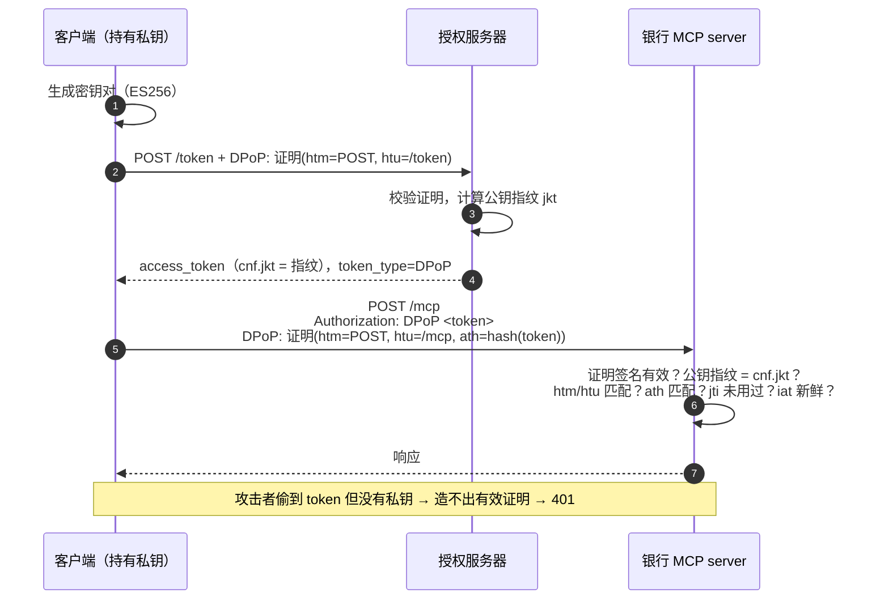
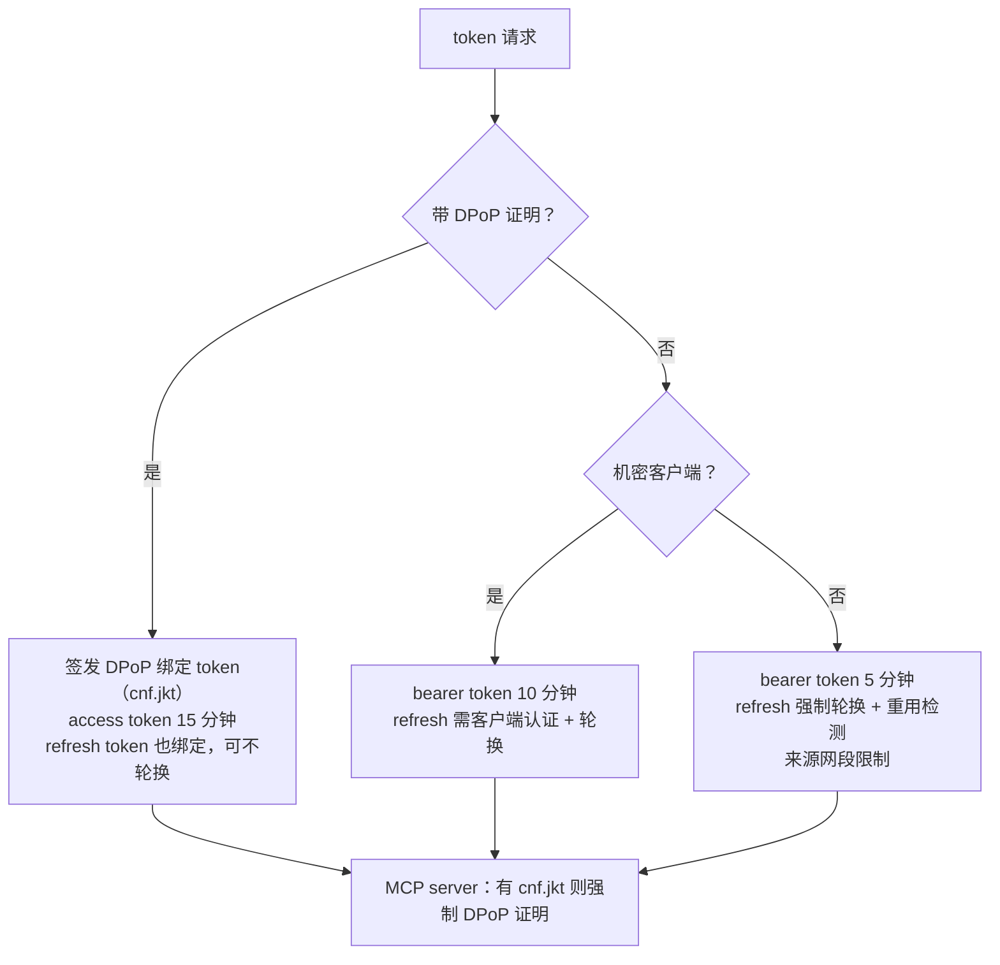

# 第 7 篇｜AuthZ（三）：持有者约束与 FAPI 2.0 差距分析

> 系列：《让 AI 替你办银行业务：面向 MCP Connector 的身份认证与授权设计》
> 规范基线：FAPI 2.0 Security Profile（Final，2025-02）；RFC 9449 DPoP；RFC 8705 mTLS；RFC 9126 PAR；MCP `2026-07-28`
> 撰写日期：2026-10-23

---

## 0. bearer token 的老问题

bearer token 的意思是「谁持有，谁就能用」。它可能从很多地方泄露：客户端存储、日志、反向代理、调试工具、MCP server 自己的错误日志。泄露之后，攻击者在任何地方都能拿它来调用 API。

金融级 API 的标准答案是**持有者约束（sender-constrained）token**：把 token 和一把私钥绑定，每次使用都要证明自己持有这把私钥。这也是 OpenID Foundation FAPI 2.0 Security Profile 的核心要求之一。

问题是：**当下的通用 AI 客户端，大多做不到。** 本篇先讲清楚两种持有者约束机制，然后把 FAPI 2.0 的要求逐条对照 MCP 规范和 Claude 的实际行为，最后给出银行在差距存在时的补偿控制。

---

## 1. 两种持有者约束机制

### 1.1 mTLS 证书绑定（RFC 8705）

客户端用 TLS 客户端证书连接授权服务器的 token 端点，授权服务器把证书指纹写入 token：

```json
{ "cnf": { "x5t#S256": "bwcK0esc3ACC3DB2Y5_lESsXE8o9ltc05O89jdN-dg2" } }
```

资源服务器在 TLS 层拿到客户端证书，计算指纹，与 token 中的 `cnf` 比对。

### 1.2 DPoP（RFC 9449）

客户端生成一对密钥，在每个请求上附一个 `DPoP` 头，内容是用私钥签名的短期 JWT（DPoP 证明）：

| 字段 | 位置 | 含义 |
|---|---|---|
| `typ` | 头 | 固定为 `dpop+jwt` |
| `jwk` | 头 | 公钥 |
| `htm` / `htu` | 载荷 | 本次请求的 HTTP 方法与 URL |
| `iat` / `jti` | 载荷 | 签发时间与唯一 ID（防重放） |
| `ath` | 载荷 | access token 的 SHA-256 哈希（向资源服务器出示时必填） |
| `nonce` | 载荷 | 服务端下发的 nonce（可选） |

授权服务器把公钥指纹写入 token：`"cnf": { "jkt": "0ZcOCORZNYy-DWpqq30jZyJGHTN0d2HglBV3uiguA4I" }`。客户端用 `Authorization: DPoP <token>` 方案出示 token。



### 1.3 对比

| | mTLS | DPoP |
|---|---|---|
| 绑定层 | TLS 层 | 应用层（HTTP 头） |
| 部署难点 | 客户端证书签发与管理；TLS 终止点要能把证书传给应用 | 应用层实现；需要 `jti` 去重存储 |
| 适合 | 少量、受控的机密客户端（如一个 AI 平台作为整体） | 大量客户端、浏览器或移动端 |
| FAPI 2.0 | 认可 | 认可 |

### 1.4 它防什么、不防什么

必须说清楚威胁模型：对云端托管的 AI 客户端来说，私钥和 token 都在同一个平台上。

- **能防**：token 从日志、缓存、代理、调试输出、MCP server 错误日志等「旁路」泄露后被滥用；
- **不能防**：AI 平台本身被攻破、私钥和 token 一起被拿走。

后者要靠第三方风险管理（第 11 篇）和架构上的「最坏情况有界」（第 2、9 篇）。

示例 MCP server 已实现 DPoP 校验（[`dpop.ts`](../code/mcp-server/src/auth/dpop.ts)）：仅当 token 带 `cnf.jkt` 时启用，校验公钥指纹、`htm`、`htu`、`ath`、`iat` 新鲜度与 `jti` 重放。

```ts
const jkt = await calculateJwkThumbprint(header.jwk as JWK, 'sha256');
if (jkt !== input.expectedJkt) throw new Error('DPoP key does not match token cnf.jkt');

const key = await importJWK(header.jwk as JWK, header.alg);
const { payload } = await jwtVerify(input.proof, key, { typ: 'dpop+jwt', maxTokenAge: '60s' });

if (payload.htm !== input.method) throw new Error('htm mismatch');
if (payload.htu !== input.url) throw new Error('htu mismatch');

const ath = createHash('sha256').update(input.accessToken).digest('base64url');
if (payload.ath !== ath) throw new Error('ath mismatch');
```

---

## 2. FAPI 2.0 逐条对照

FAPI 2.0 Security Profile 于 2025 年 2 月成为 Final 规范（Message Signing 于 2025 年 9 月 Final）。下表摘取与 AI connector 最相关的要求（章节号为 Security Profile 原文），对照 MCP `2026-07-28` 的要求，以及撰写时 Claude connector 文档描述的行为。

| # | FAPI 2.0 要求 | MCP 2026-07-28 | Claude（据文档） | 差距 |
|---|---|---|---|---|
| 1 | AS 只支持**机密客户端**（§5.3.2.1） | 允许公共客户端 | CIMD／DCR 下为公共客户端；`oauth_anthropic_creds` 为机密客户端 | **部分**：仅托管凭证模式满足 |
| 2 | 客户端认证用 **mTLS 或 `private_key_jwt`**（§5.3.2.1） | CIMD 下 MAY 使用 `private_key_jwt` | 托管凭证模式文档描述为 client ID + secret | **有**：共享密钥不在 FAPI 认可方式内 |
| 3 | 只签发**持有者约束** token（§5.3.2.1） | 未要求 | 文档未提及 DPoP／mTLS | **有**：最大差距 |
| 4 | 强制 **PAR**，拒绝非 PAR 的授权请求（§5.3.2.2） | 未要求 | 文档未提及 | **有** |
| 5 | PKCE `S256`（§5.3.2.2） | MUST | 每次都发送 | 无 |
| 6 | 返回 RFC 9207 `iss`（§5.3.2.2） | AS SHOULD；客户端 MUST 校验 | 文档未单独说明 | AS 侧可满足 |
| 7 | `response_type=code` | 授权码流程 | 是 | 无 |
| 8 | 授权码有效期 ≤ 60 秒；不可重用 | — | — | AS 侧可满足 |
| 9 | AS **不应轮换** refresh token（除特殊情况）（§5.3.2.1） | 公共客户端 MUST 轮换 refresh token | 文档要求公共客户端连接轮换 | **冲突**：见下文 |
| 10 | 算法限 PS256／ES256／EdDSA，禁 `none`（§5.4.1） | — | — | AS／RS 侧可满足 |
| 11 | RS 校验 token 有效性、撤销状态、持有者约束（§5.3.4） | 校验 `aud` 等 | — | 持有者约束部分受限于第 3 项 |
| 12 | 不接受 query 中的 token | MUST NOT | 只用请求头 | 无 |

> 「据文档」指 Anthropic 的 *Authentication for connectors* 页面在撰写时的内容。文档未提及不等于一定不支持，银行应在接入测试中实测确认。

**第 9 项的冲突**值得单独解释。FAPI 2.0 不轮换 refresh token，是因为它的 refresh token 本身是持有者约束的，偷了也用不了，轮换只会带来并发刷新失败等可用性问题。OAuth 2.1 和 MCP 则要求：公共客户端的 refresh token 要么持有者约束，要么轮换。**当 token 无法做持有者约束时，轮换就是必需的补偿**，两者并不真正矛盾，只是适用前提不同。

**结论：以撰写时通用 AI 客户端的能力，银行的 AI connector 无法做到 FAPI 2.0 合规。** 正确的态度不是假装合规，也不是因此放弃，而是：

1. 承认差距，写进风险评估；
2. 用架构和补偿控制，把差距带来的剩余风险压到可接受水平；
3. 在银行侧先把 FAPI 能力准备好，等客户端跟上。

---

## 3. 补偿控制

### 3.1 第一道也是最重要的一道：让 token 不值钱

最有效的补偿不在 OAuth 层，而在第 2 篇的能力分级：**AI 渠道的 token 不具备任何执行资金变动的能力。** 攻击者偷到一枚 AI connector 的 token，最多能做：

- 读取该用户授权的账户数据（严重，但不是资金损失）；
- 在 RAR 范围内**起草**付款，而每一笔都要用户在已绑定设备上签核。

这就是为什么第 9 篇的「AI 起草，用户签核」不只是用户体验设计，而是这套架构在当前客户端能力下**能够成立的前提**。

### 3.2 token 生命周期收紧

| 控制 | 建议值 | 说明 |
|---|---|---|
| access token 有效期 | 5–10 分钟（公共 bearer 客户端） | Claude 文档称会在过期前最多 5 分钟主动刷新，并在收到 401 时被动刷新。若取 5 分钟，几乎每次调用都可能触发刷新，需评估 token 端点容量与轮换时的并发刷新；容量不足时取 10 分钟 |
| refresh token 轮换 | 必须 | 每次刷新签发新 refresh token，旧的立即失效 |
| 重用检测 | 必须 | 旧 refresh token 被再次使用 → 判定泄露 → 撤销整个 grant |
| refresh token 绝对有效期 | 30–90 天 | 与重新认证周期对齐（第 4 篇） |
| 高风险 scope 下的 access token | ≤ 5 分钟 | 含 `payments:draft` 时不放宽 |

参考实现：[`token_policy.py`](../code/authz-server/token_policy.py)。

### 3.3 网络层的「伪持有者约束」

AI 平台的出站流量来自固定网段。Claude 文档公布的出站网段为 `160.79.104.0/21`。银行可以：

- 在授权服务器 token 端点和 MCP server 上，对 AI 客户端的 token **限定来源网段**；
- 来自其他地址的使用一律拒绝并告警。

这相当于把 token 绑定到「AI 平台的网络出口」。局限也要讲清楚：它绑定的是**平台**而不是具体客户端，同一平台上的其他租户共享这些出口。但它能挡住最常见的场景：token 被偷后在攻击者自己的基础设施上使用。

### 3.4 优先使用机密客户端

对目录上架的 connector，优先选择 Anthropic 托管的机密客户端凭证（`oauth_anthropic_creds`），而不是 CIMD 公共客户端：

- 银行可以对这个 `client_id` 单独设置策略、单独限流、一键下线；
- refresh token 兑换需要客户端认证，单纯偷到 refresh token 不足以换新 token。

剩余差距是客户端认证方式为共享密钥，而非 FAPI 要求的 `private_key_jwt` 或 mTLS。银行可以在与 AI 平台的商务和技术对接中提出这一需求。

### 3.5 行为检测

授权服务器和 MCP server 应把以下信号送入风控（第 11 篇）：

- 同一 grant 的 token 从多个网段或地区使用；
- refresh token 重用；
- 调用频率、查询模式突变（例如短时间内遍历全部账户的全部流水）；
- 大量起草后又被用户拒绝的草稿（可能是注入攻击在试探）。

---

## 4. 银行侧的 FAPI 就绪

不要等客户端。银行现在就可以把服务端能力准备好，让支持 DPoP 的客户端自然获得更强的保护：



- AS 元数据声明 `dpop_signing_alg_values_supported`；
- MCP server 的 Protected Resource Metadata 同样声明（RFC 9449 §5.1）；
- MCP server 对带 `cnf.jkt` 的 token **强制**要求 DPoP 方案与有效证明，不允许降级为 bearer 使用（示例 `bankAuth` 中间件已实现）；
- DPoP 相关错误用 `WWW-Authenticate: DPoP error="invalid_dpop_proof"` 回挑战（RFC 9449 §7.1）；
- PAR 端点上线，对认识 PAR 的客户端开放，对 AI 客户端暂不强制。

### 4.1 DPoP 落地的几个细节

- **服务端 nonce**：RFC 9449 允许服务端通过 `DPoP-Nonce` 头下发 nonce，要求后续证明携带，从而限制客户端预先生成证明。FAPI 2.0 允许使用（MAY）。启用后，客户端第一次请求会收到 `use_dpop_nonce` 错误并重试，延迟增加一个往返；对 AI 客户端可以只在 token 端点启用。
- **时钟**：示例实现接受 60 秒内签发的证明。FAPI 2.0 要求接受未来 10 秒内的 `iat`，拒绝超过 60 秒的未来时间。
- **`htu` 的规范化**：比较时去掉 query 和 fragment。若 MCP server 在反向代理之后，要用对外的 URL（`config.resourceUrl.origin` + 路径）计算，而不是内部看到的主机名，否则所有证明都会校验失败。
- **`jti` 去重存储**：多实例部署时必须用共享存储（例如带 TTL 的键值存储），保存时长覆盖证明的可接受窗口即可。
- **authorization code 绑定**：FAPI 2.0 要求使用 DPoP 时支持 authorization code 与 DPoP 密钥绑定（`dpop_jkt` 授权请求参数），防止授权码被另一把密钥兑换。

### 4.2 mTLS 对云端 AI 平台可行吗

直觉上 mTLS 更难，但对「一个 AI 平台作为一个机密客户端」的场景，它其实可能比 DPoP 更容易落地：

- 银行只需要为这一个平台签发（或登记）一张客户端证书，而不是面对成千上万的终端；
- 绑定发生在 TLS 层，AI 平台的应用代码几乎不用改；
- 难点在 TLS 终止：银行的 WAF／负载均衡要能做双向 TLS，并把客户端证书指纹可靠地传给 MCP server 和授权服务器。

如果银行与 AI 平台有直接的商务关系（例如目录上架），可以把 mTLS 作为技术对接的谈判选项之一。

### 4.3 双栈过渡期

当某个 AI 客户端开始支持 DPoP 时，会有一段时间两种 token 并存：

1. AS 根据 token 请求是否带 DPoP 证明，签发绑定或不绑定的 token（第 4 节流程图）；
2. MCP server 对绑定 token 强制校验，对 bearer token 维持补偿控制；
3. 观察绑定 token 的占比，达到目标后，对该 `client_id` 关闭 bearer 签发；
4. 关闭后，该客户端的 token 生命周期可以按第 3.2 节表格放宽，并重新评估风险接受声明。

---

## 5. 风险接受声明模板

把差距和补偿写成一份正式的风险接受声明，由风险负责人签署：

> **差距**：AI 客户端（Claude，`client_id=…`）不支持持有者约束 token 与 PAR，客户端认证方式为共享密钥，不满足 FAPI 2.0 Security Profile §5.3.2.1、§5.3.2.2 的相关要求。
>
> **剩余风险**：access token 或 refresh token 从 AI 平台侧泄露后，可在有效期内被用于读取已授权账户数据，或在 RAR 范围内起草付款。
>
> **补偿控制**：① AI 渠道无执行类能力，所有资金操作须于已绑定设备逐笔签核；② access token 5–10 分钟，refresh token 轮换并检测重用；③ 限定 AI 平台出站网段；④ 行为风控；⑤ 第三方风险评估与合同条款。
>
> **复审触发**：客户端支持 DPoP／mTLS 或 PAR 时；FAPI 或 MCP 规范更新时；发生相关安全事件时；至少每年一次。

---

## 给银行的设计决策清单

1. **在风险评估中正式承认 FAPI 2.0 差距**，按第 5 节模板签署风险接受，并设定复审触发条件。
2. **把「AI 渠道无执行能力」作为持有者约束缺失时的首要补偿**，任何放宽这一点的需求都必须重新评估本篇的全部差距。
3. **对 bearer 客户端收紧生命周期**：access token 5–10 分钟、refresh token 强制轮换并检测重用、绝对有效期与重新认证周期对齐；并限定 AI 平台出站网段。
4. **目录上架的 connector 优先使用机密客户端**，并推动 AI 平台支持 `private_key_jwt`／mTLS 与 DPoP。
5. **银行侧现在就实现 DPoP 与 PAR**：元数据声明支持，MCP server 对绑定 token 强制校验证明，让支持的客户端自动获得更强保护。

---

## 参考资料

- OpenID Foundation, *FAPI 2.0 Security Profile*（Final，2025-02）. <https://openid.net/specs/fapi-security-profile-2_0-final.html>
- OpenID Foundation, *FAPI 2.0 Message Signing*（Final，2025-09）. <https://openid.net/specs/fapi-message-signing-2_0-final.html>
- IETF, RFC 9449 *OAuth 2.0 Demonstrating Proof of Possession (DPoP)*.
- IETF, RFC 8705 *OAuth 2.0 Mutual-TLS Client Authentication and Certificate-Bound Access Tokens*.
- IETF, RFC 9126 *OAuth 2.0 Pushed Authorization Requests*.
- IETF, RFC 9700 *Best Current Practice for OAuth 2.0 Security*.
- Model Context Protocol Specification `2026-07-28`, *Security Considerations — Token Theft*. <https://modelcontextprotocol.io/specification/2026-07-28/basic/authorization/security-considerations>
- Anthropic, *Authentication for connectors*（Token refresh、Network reference）. <https://claude.com/docs/connectors/building/authentication>
