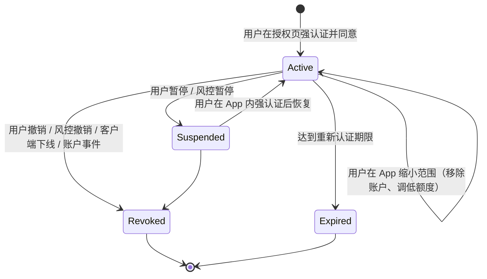
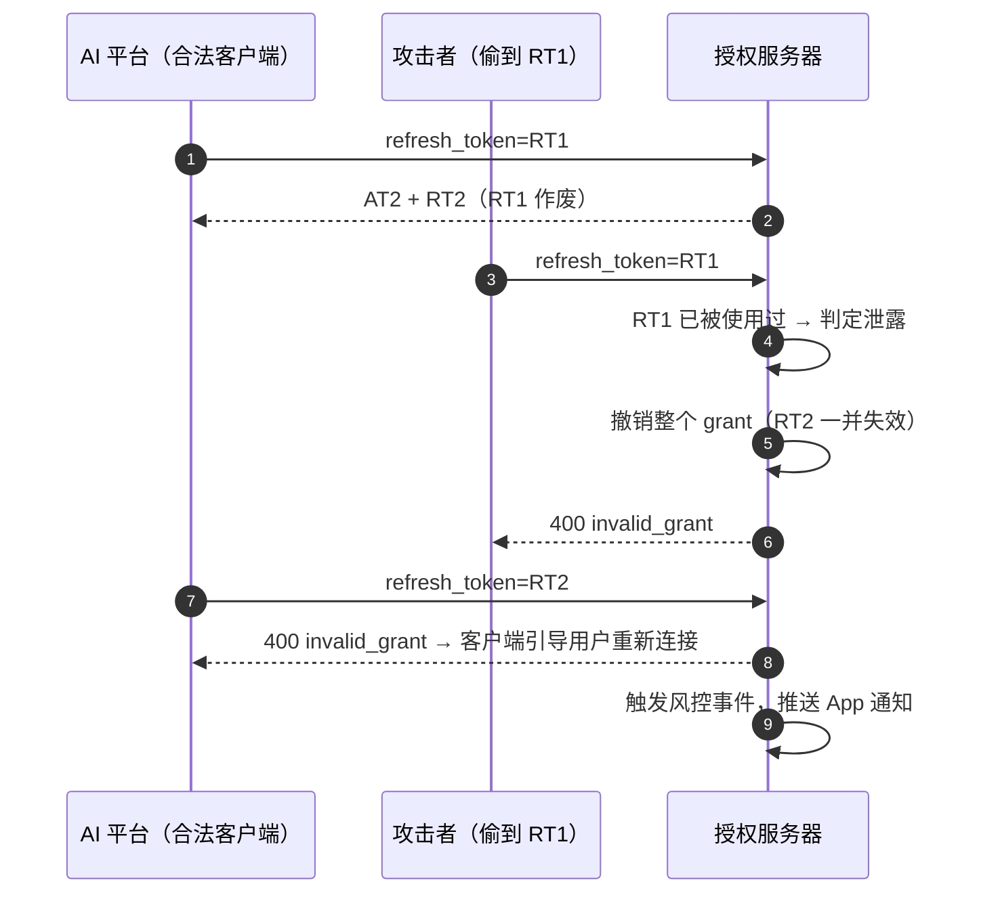
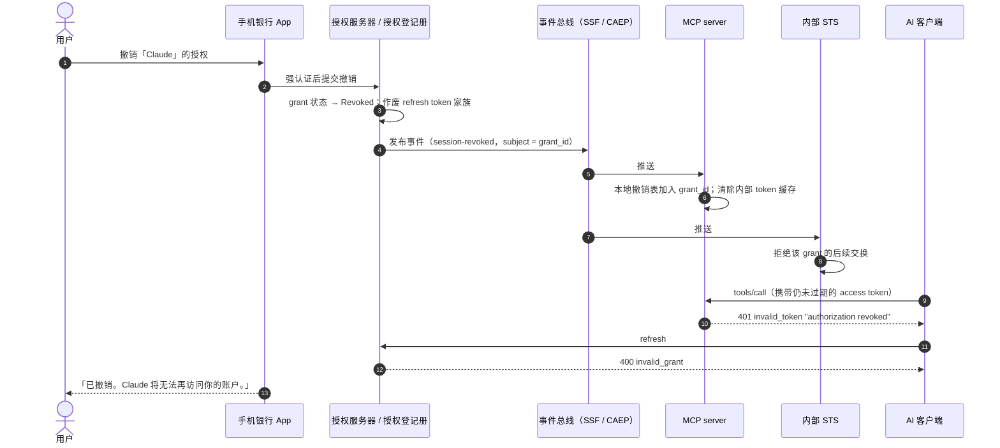
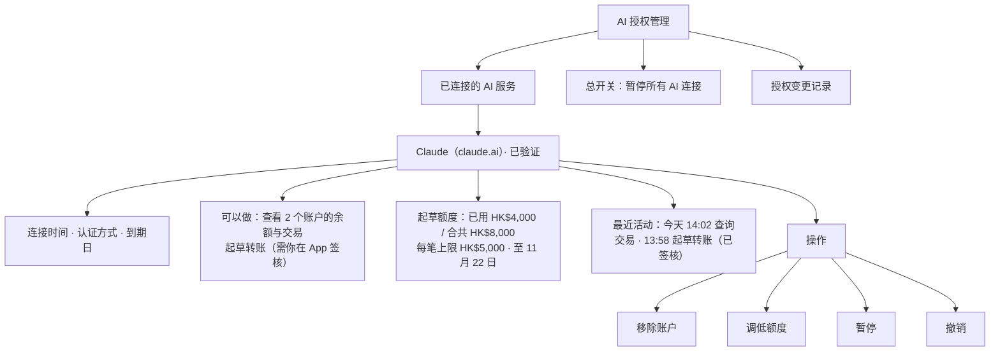

# 第 8 篇｜AuthZ（四）：token 生命周期、撤销与用户授权管理中心

> 系列：《让 AI 替你办银行业务：面向 MCP Connector 的身份认证与授权设计》
> 规范基线：OAuth 2.1 `draft-ietf-oauth-v2-1-13`；RFC 7009；RFC 7662；OpenID Shared Signals Framework 1.0 与 CAEP 1.0（Final，2025）；MCP `2026-07-28`
> 撰写日期：2026-10-23

---

## 0. 授权是一个有生命的对象

很多团队把 OAuth 授权当成一次性事件：用户点同意，拿到 token，结束。对 AI connector，这样理解是危险的。用户在某个周末下午授权了 Claude，之后可能几个月都想不起来这件事，而 AI 平台会持续替他刷新 token、调用工具。

所以我们要把**授权（grant）**当作一个有完整生命周期的业务对象来管理：它被建立、被使用、被续期、被扩大或缩小、被暂停、被撤销、最终过期。每一个状态变化都要能被用户看见，并且能实时影响每一次工具调用。

---

## 1. 授权的状态机



几个设计要点：

- **增量授权不是新 grant**，而是同一 grant 的扩展（需重新同意），这样授权管理中心里一个 AI 连接只占一行；
- **缩小范围不需要重新走 OAuth**：用户在 App 中移除账户或调低额度，授权登记册即时更新，经由 Token Exchange（第 6 篇）在下一次调用时生效；
- **暂停与撤销分开**：暂停可恢复，适合「我出国这两周先停掉」；撤销不可逆，需要重新授权；
- **到期即失效**：重新认证期限（第 4 篇建议只读 ≤ 90 天、含起草权限 ≤ 30 天）到了就进入 Expired，AI 客户端刷新时得到 `invalid_grant`，引导用户重新连接。

---

## 2. 各类凭证与句柄的生命周期

| 对象 | 典型有效期 | 存放位置 | 失效方式 |
|---|---|---|---|
| 授权（grant） | 30–90 天 | 银行授权登记册 | 到期、撤销 |
| refresh token | 每次刷新轮换；绝对有效期与 grant 一致 | AI 平台 | 轮换、重用检测、grant 撤销 |
| access token（外部） | 5–15 分钟（第 7 篇） | AI 平台 | 过期；MCP server 实时检查 grant 状态 |
| 内部 token | ≤ 5 分钟 | MCP server 缓存 | 过期；grant 撤销时清除缓存 |
| 支付草稿 | 15 分钟 | 银行 | 签核、拒绝、撤回、过期 |
| MRTR `requestState` | 15 分钟 | 经客户端往返 | HMAC 过期 |

### 2.1 refresh token 轮换与重用检测

对公共客户端，OAuth 2.1 和 MCP 都要求 refresh token 要么做持有者约束，要么轮换。轮换的真正价值在于**重用检测**：



实现细节：

- **按 grant 维护 refresh token 家族**，任何一个旧 token 被重用，整个家族作废；
- **给并发刷新留一个很短的宽限窗口**（例如 2–5 秒内允许前一个 RT 再用一次并返回相同结果），否则客户端的并发刷新会被误判为泄露；
- **失效时一律返回 `invalid_grant`**。Claude 文档特别要求这一点：返回 `invalid_request` 或自定义错误码，可能让客户端反复重试而不是引导用户重新授权；
- **轮换时，新 refresh token 必须和使旧 token 作废的是同一个响应**。

---

## 3. 撤销：四种来源，一条传播链

### 3.1 撤销从哪里来

| 来源 | 例子 | 范围 |
|---|---|---|
| **用户** | 在 App 授权管理中心点「撤销」 | 单个 grant |
| **银行风控** | refresh token 重用、异常调用模式 | 单个 grant，或该用户的全部 AI grant |
| **账户事件** | 设备重新绑定、密码重置、卡挂失、被标记为疑似受骗、销户 | 该用户的全部 AI grant |
| **客户端级** | AI 平台发生安全事件 | 该 `client_id` 的全部 grant（一键下线） |

账户事件联动是最容易漏掉的一项。用户刚刚因为手机被盗重新绑定了设备，攻击者却仍可以通过之前建立的 AI 授权读取账户——这显然不合理。建议：**设备重新绑定、疑似欺诈标记这两类事件，自动撤销该用户的全部 AI 授权。**

### 3.2 AI 平台侧的「断开连接」

用户在 Claude 里删除 connector，Claude 是否会调用银行的 RFC 7009 撤销端点？撰写时 Claude 的 connector 文档没有说明。**银行不能依赖 AI 平台通知撤销**：

- 授权登记册中的 grant 仍然有效，直到用户在 App 中撤销或到期；
- 授权管理中心要显示「最后使用时间」，长时间未使用的授权在 App 中提醒用户清理；
- 长期未使用的 grant 可以由银行自动暂停。

### 3.3 传播：从撤销到下一次调用被拒



关键在第 7–11 步：**access token 还没过期，但下一次调用已经被拒绝。** 这依赖 MCP server 在每个请求中检查 grant 状态，而不是只校验 JWT 签名和 `exp`。示例 `bankAuth` 中间件：

```ts
if (!isClientEnabled(auth.clientId)) {
  audit({ action: 'authn', outcome: 'denied', reason: 'client_disabled' }, auth);
  return challenge(res, 401, 'invalid_token', 'client disabled by bank');
}
if (!isGrantActive(extra.grantId)) {
  audit({ action: 'authn', outcome: 'denied', reason: 'grant_revoked' }, auth);
  return challenge(res, 401, 'invalid_token', 'authorization revoked');
}
```

### 3.4 JWT 自校验还是内省？

| 方案 | 优点 | 缺点 |
|---|---|---|
| JWT 自校验（RFC 9068） | 无需调用 AS，延迟低 | 撤销只能靠短有效期或额外的撤销表 |
| 内省（RFC 7662） | 每次都拿到实时状态 | 每次调用都依赖 AS，AS 成为关键路径 |
| **JWT + 事件驱动的撤销表（推荐）** | 低延迟，撤销秒级生效 | 需要事件基础设施；事件丢失时依赖兜底 |

推荐方案的兜底：MCP server 本地撤销表同时按 TTL（例如 60 秒）定期从授权登记册拉取增量，事件丢失时最多延迟一个 TTL。

**事件标准**：OpenID Foundation 的 Shared Signals Framework 1.0 与 CAEP 1.0 已于 2025 年成为 Final 规范。SSF 定义安全事件令牌（SET）的传输方式，CAEP 定义会话撤销、凭证变更等事件类型。银行内部使用 SSF/CAEP 的好处是：同一套事件既能驱动 MCP server，也能驱动其他依赖同一身份体系的系统。

---

## 4. 用户授权管理中心

授权管理中心是这套设计里**用户唯一能看见、能控制 AI 授权的地方**，必须放在银行自己的 App 和网银里，而不是 AI 平台上。

### 4.1 信息架构



### 4.2 设计原则

1. **客户端身份要可信**。显示的名称来自银行的客户端登记（预注册）或 CIMD 允许名单中的域名，而不是客户端自报的 `client_name`。允许名单之外的客户端根本不会出现在这里。
2. **权限用人话描述**，与同意页（第 5 篇）用同一套文案生成器，保证用户在两处看到的一致。
3. **额度显示消耗**。RAR 只表达上限，「已用多少」来自服务端台账。
4. **最近活动来自审计日志**（第 11 篇），至少显示工具类别、时间和结果。
5. **缩小范围即时生效，扩大范围必须回到 OAuth 授权流程。** 用户在 App 里可以移除账户、调低额度，但不能在 App 里直接调高 AI 的额度——调高要从 AI 侧触发增量授权并重新同意。这是第 2 篇「安全方向不对称」原则在授权管理上的体现。
6. **总开关**。一键暂停所有 AI 连接，恢复时需要强认证。这与 HKMA「Bye to unused functions」的精神一致：让客户能主动关掉不用的高风险功能。

### 4.3 通知

| 事件 | 通知方式 |
|---|---|
| 新建 AI 授权 | App 推送（立即） |
| 授权范围扩大 | App 推送（立即） |
| AI 起草了一笔付款 | App 推送（即签核请求本身） |
| 风控暂停或撤销 | App 推送 + 短信 |
| 授权即将到期 | App 内提醒（提前 7 天） |
| 长期未使用 | App 内提醒（例如 30 天未用） |

---

## 5. 授权登记册的数据模型

```json
{
  "grant_id": "grt_8Kd2…",
  "status": "active",
  "cif": "CIF0012345678",
  "sub_pairwise": "pw_4f9c1e…",
  "client_id": "examplebank-claude-hosted",
  "client_display": { "name": "Claude", "domain": "claude.ai", "verified": true },
  "created_at": "2026-10-23T05:58:00Z",
  "auth_context": { "acr": "urn:examplebank:acr:bound-device", "amr": ["hwk", "face"], "device_id": "dev_…" },
  "scopes": ["accounts:read", "transactions:read", "payments:draft"],
  "accounts": ["acc_7Hq2", "acc_9Lm4"],
  "authorization_details": [{ "type": "https://examplebank.hk/rar/payment-draft/v1", "…": "…" }],
  "reauth_due_at": "2026-11-22T05:58:00Z",
  "last_used_at": "2026-10-23T06:02:11Z",
  "refresh_family_id": "rtf_…",
  "history": [
    { "at": "2026-10-23T05:58:00Z", "event": "created", "by": "user" },
    { "at": "2026-10-23T06:00:30Z", "event": "scope_expanded", "by": "user", "added": ["payments:draft"] }
  ]
}
```

---

## 6. 到期与续期体验

重新认证期限到了，授权进入 Expired。用户在 AI 里下一次提问时，体验会是这样：

1. AI 客户端刷新 token，得到 `invalid_grant`；
2. 客户端提示用户重新连接，打开银行授权页；
3. 用户用已绑定设备确认身份；
4. 同意页**默认带出上一次授权的范围**（账户、额度），用户确认或调整；
5. 新 grant 建立，旧 grant 的历史记录保留并关联。

几个细节：

- **提前提醒**：到期前 7 天在 App 内提醒，用户可以在 App 内直接续期（强认证后延长期限），避免在 AI 对话中途被打断；
- **续期不扩大范围**：续期只延长时间，扩大权限仍走增量授权；
- **起草额度重新计算**：新 grant 的累计额度从零开始，旧 grant 下未签核的草稿随旧 grant 失效。

---

## 7. 失败模式

| 失败 | 后果 | 对策 |
|---|---|---|
| 撤销事件丢失 | 撤销后仍可调用，直到 access token 过期 | 本地撤销表定期全量或增量同步（≤ 60 秒）；access token 本身短期 |
| 授权登记册不可用 | MCP server 无法确认 grant 状态 | **闭合**：拒绝请求，而不是放行；对只读请求可以容忍短时缓存，对起草请求一律实时确认 |
| 客户端并发刷新 | 被误判为 refresh token 重用，grant 被撤销 | 短宽限窗口；同一宽限窗口内返回相同结果 |
| 时钟漂移 | token 过早失效或过晚失效 | 统一时间源；校验时留 30 秒容差 |
| 用户在多个设备上操作授权管理中心 | 状态冲突 | 以授权登记册为唯一事实来源，每次操作带版本号 |
| AI 平台长期不调用 | 授权一直挂着，用户已忘记 | 长期未用提醒；超过阈值自动暂停 |

---

## 8. 撤销时与用户和 AI 的沟通

撤销不只是技术动作，还要让各方得到清楚的反馈：

- **对用户**：App 中立即显示「已撤销，Claude 将无法再访问你的账户」；若有未签核的草稿，一并列出并标为作废；
- **对 AI 客户端**：MCP server 返回 `401 invalid_token`，`error_description` 写明「authorization revoked」，客户端据此提示用户，而不是反复重试；
- **对风控与客服**：撤销事件带上来源（用户、风控、账户事件、客户端下线），客服处理投诉时可以直接查到。

风控撤销的情形还要考虑**通知措辞**：如果是疑似欺诈导致的撤销，通知中不应暴露具体的风控规则，但要告诉用户如何联系银行。

---

## 9. 运营指标

| 指标 | 目标 |
|---|---|
| 撤销到 MCP server 拒绝的延迟（P99） | ≤ 5 秒（事件路径），≤ 60 秒（兜底） |
| 客户端一键下线演练 | 每季度一次，全量生效 ≤ 1 分钟 |
| refresh token 重用事件 | 每一起都进入人工复核 |
| 长期未用授权占比 | 持续下降（说明清理提醒有效） |
| 用户撤销率、撤销原因 | 产品与风控的共同输入 |

---

## 给银行的设计决策清单

1. **把 grant 作为一等业务对象**，建立授权登记册，完整记录状态机与变更历史；增量授权扩展同一 grant，缩小范围即时生效。
2. **refresh token 按家族轮换并做重用检测**，失效统一返回 `invalid_grant`，为并发刷新设置短宽限窗口。
3. **MCP server 每个请求都检查 grant 状态与客户端开关**，以 SSF／CAEP 事件驱动本地撤销表，并用 ≤ 60 秒的定期同步兜底。
4. **账户事件联动撤销**：设备重新绑定、疑似欺诈标记时自动撤销该用户全部 AI 授权；不依赖 AI 平台通知撤销。
5. **在 App 中提供授权管理中心**：可信的客户端身份、人话权限、额度消耗、最近活动、移除账户、调低额度、暂停、撤销与总开关；扩大权限只能经由 OAuth 重新同意。

---

## 参考资料

- IETF, draft-ietf-oauth-v2-1-13 §4.3（Refresh Token Grant；refresh token 轮换与持有者约束）.
- IETF, RFC 7009 *OAuth 2.0 Token Revocation*；RFC 7662 *OAuth 2.0 Token Introspection*；RFC 9068.
- OpenID Foundation, *Shared Signals Framework 1.0*（Final）. <https://openid.net/specs/openid-sharedsignals-framework-1_0-final.html>
- OpenID Foundation, *OpenID Continuous Access Evaluation Profile 1.0*（Final）. <https://openid.net/specs/openid-caep-1_0-final.html>
- Model Context Protocol Specification `2026-07-28`, *Authorization — Refresh Tokens*；*Security Considerations — Token Theft*. <https://modelcontextprotocol.io/specification/2026-07-28/basic/authorization>
- Anthropic, *Authentication for connectors — Token refresh*. <https://claude.com/docs/connectors/building/authentication>
- HKMA, *"E-Banking Security ABC"*（附件，2025-04-11）.
