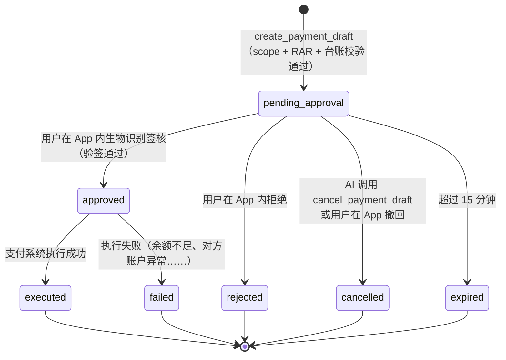
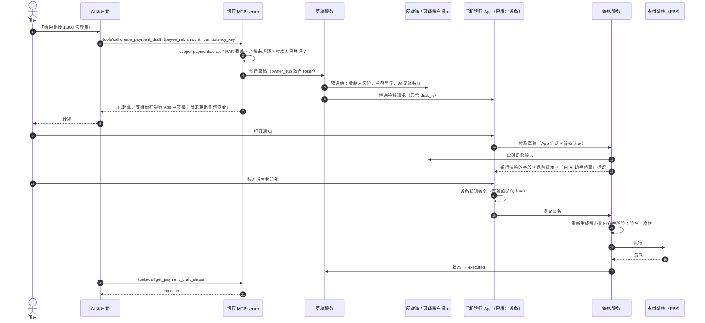

# 第 9 篇｜AuthZ（五）：高风险操作的「AI 起草，用户签核」

> 系列：《让 AI 替你办银行业务：面向 MCP Connector 的身份认证与授权设计》
> 规范基线：MCP `2026-07-28`（Elicitation：URL mode；Multi Round-Trip Requests）；OpenID Connect CIBA Core 1.0；RFC 9396；HKMA「E-Banking Security ABC」（2025-04）
> 撰写日期：2026-10-23

---

## 0. 把 IBKR 的闸门加厚

第 1 篇里，IBKR 的模式是：AI 生成订单指令，用户在 IBKR 界面点「Review & Submit」。到了银行，我们要把这道闸门加厚三层：

1. **确认必须在已绑定设备上，用生物识别完成**——不是网页上点一下；
2. **用户签的必须正是将被执行的内容**——金额、收款人任何一项变了，签名就失效（dynamic linking）；
3. **签核界面由银行渲染，附带银行自己的风险提示**——不使用 AI 生成的任何文字。

本篇是整个系列的核心：前八篇的认证与授权，都是为了把 AI 的能力边界压到「草稿」；这一篇讲清楚草稿如何变成一笔真实的付款，以及为什么 AI 在这条路径上**没有任何可以介入的点**。

---

## 1. 设计目标

| # | 目标 | 实现手段 |
|---|---|---|
| G1 | AI 无法让资金移动 | 工具集中只有 `create_payment_draft`、`get_payment_draft_status`、`cancel_payment_draft`；签核服务不在 MCP 路径上 |
| G2 | 所见即所签（WYSIWYS） | 签核界面只展示银行从草稿记录渲染的字段 |
| G3 | 签核与交易内容绑定 | 设备私钥对草稿规范化内容签名；执行前重新验签 |
| G4 | 签核在受信设备上完成 | 手机银行 App + 生物识别，符合 HKMA「Authenticate in-App」 |
| G5 | 不依赖 AI 客户端的特殊能力 | 主通道是银行推送；URL 模式 elicitation 是增强 |
| G6 | 可重试、不重复、会过期 | 幂等键、草稿 15 分钟过期、签名一次性 |

---

## 2. 草稿对象与状态机



注意哪些转换是 AI 能触发的：只有「创建」和「撤回」。撤回是让账户更安全的方向，所以允许 AI 做（第 2 篇的不对称原则）。从 `pending_approval` 到 `approved`，**只有银行签核服务能做**，而签核服务只接受来自已绑定设备的签名。

草稿的关键字段（[`drafts/store.ts`](../code/mcp-server/src/drafts/store.ts)）：

```ts
export interface PaymentDraft {
  draft_id: string;           // 不可猜测：drf_ + 128 位随机数
  owner_sub: string;          // 由已验证 token 决定，不接受客户端传入
  client_id: string;
  grant_id: string;
  debtor_account_ref: string;
  payee_ref: string;
  amount: string;
  currency: 'HKD';
  purpose_from_ai: string;    // 只作参考，签核页明确标注「由 AI 填写」
  status: DraftStatus;
  created_at: number;
  expires_at: number;
  idempotency_key: string;
}
```

---

## 3. 主流程



两个要点：

- **第 7 步推送里只有 `draft_id`**，App 打开后用自己的认证会话到签核服务拉取内容。推送通道本身不承载交易信息。
- **第 8 步 MCP server 对 AI 的回复措辞经过设计**：「尚未转出任何资金」。如果工具返回「转账已提交」，模型很可能告诉用户「已经转好了」，用户就不会去 App 里看——而 App 里那条签核请求，可能正是一次注入攻击产生的（第 10 篇）。

---

## 4. 签核通道：三种做法

### 4.1 通道 A：推送到已绑定设备（主通道）

就是第 3 节的流程。优点是完全不依赖 AI 客户端的能力，也天然符合 HKMA 对高风险交易的认证要求。

### 4.2 通道 B：MCP URL 模式 elicitation（增强）

MCP `2025-11-25` 引入了 URL 模式 elicitation，`2026-07-28` 把它改为通过**多轮请求（MRTR）**下发：服务端在工具结果中返回 `resultType: "input_required"`，其中携带一个 `elicitation/create` 请求；客户端处理后带着 `inputResponses` 和 `requestState` 重试原请求。

规范明确把它定位为「不能经过 MCP 客户端的敏感交互」，例子正是支付。对银行有价值的规范要求：

| 一方 | 要求 |
|---|---|
| 客户端 | MUST 向用户展示完整 URL 并取得同意后才打开；MUST NOT 预取 URL；MUST 以客户端和 LLM 都**无法查看内容和用户输入**的方式打开（例如 iOS 上用 `SFSafariViewController` 而不是 `WKWebView`）；SHOULD 突出显示域名 |
| 服务端 | MUST NOT 在 URL 中放入用户的个人信息或凭证；MUST NOT 提供预先认证过的 URL；MUST 确认打开 URL 的人就是发起这次 elicitation 的用户（防钓鱼） |
| 语义 | 客户端返回 `accept` 只表示用户同意打开链接，**不表示交互已完成**；服务端在客户端重试时自行判断结果 |

示例实现（[`tools/payments.ts`](../code/mcp-server/src/tools/payments.ts)）在客户端声明支持 URL 模式时，额外返回签核页链接：

```ts
const envelope = ctx.mcpReq.envelope as Record<string, unknown> | undefined;
const caps = envelope?.[CLIENT_CAPABILITIES_META_KEY] as ClientCapabilities | undefined;
if (caps?.elicitation?.url) {
  const approveUrl = new URL(config.approvalBaseUrl);
  approveUrl.searchParams.set('d', draft.draft_id); // 不含任何个人信息
  return inputRequired({
    inputRequests: {
      approve: inputRequired.elicitUrl({
        url: approveUrl.href,
        message: '请在示例银行页面核对收款人与金额并完成验证。签核也可直接在示例银行 App 推送通知中完成。',
      }),
    },
    requestState: await codec.mint({ draft_id: draft.draft_id }, ctx),
  });
}
```

客户端重试时，服务端从**经过 HMAC 校验、绑定当前用户**的 `requestState` 中取回 `draft_id`，返回草稿当前状态，而不是再建一笔：

```ts
const resumed = ctx.mcpReq.requestState<DraftState>();
if (resumed && typeof resumed === 'object') {
  const d = getOwnedDraft(resumed.draft_id, extra.sub);
  if (!d) throw new Error('draft not found');
  return draftResult(d.draft_id, d.status, d.amount, d.payee_ref, d.expires_at);
}
```

**关键：签核页面上仍然要求已绑定设备确认。** 用户在桌面浏览器打开签核页，页面先确认登录用户就是草稿所有者，然后显示一个二维码，用户用 App 扫码完成生物识别签名。网页本身不提供「点击确认」按钮，也不提供短信 OTP。URL 模式 elicitation 解决的是「把用户带到正确的地方」，不是「在那里用更弱的方式确认」。

本地测试中，我们走通了 URL 模式的完整往返，并把 `requestState` 篡改一个字节后重试，服务器返回 `-32602 Invalid or expired requestState`。

### 4.3 通道 C：CIBA + RAR 的「单笔授权」

对已有 CIBA 基础设施的银行，还有一种更标准化的做法：把**每一笔付款当作一次独立的 OAuth 授权**。

- MCP server（或其后的支付服务）作为 **CIBA 客户端**，向授权服务器的 backchannel 端点发起认证请求，`authorization_details` 中放入**这一笔**付款的具体内容（金额、收款人、账户），`binding_message` 放入一段简短的对照码；
- 授权服务器通过 App 请用户确认；
- 用户确认后，授权服务器签发一枚**只对这一笔付款有效**的 token；
- 支付系统只在收到这枚 token 时执行，并校验其中的 `authorization_details` 与执行内容完全一致。

这与开放银行中「支付同意（payment consent）」的思路一致，好处是签核结果是一枚标准的、可审计的 OAuth 凭证。代价是 CIBA 链路更复杂。

### 4.4 对比

| | A：App 推送 | B：URL 模式 elicitation | C：CIBA + RAR |
|---|---|---|---|
| 依赖 AI 客户端能力 | 否 | 是（URL 模式） | 否 |
| 用户体验 | 需切到 App | 在 AI 对话中给出链接，扫码确认 | 需切到 App |
| 标准化程度 | 银行自有 | MCP 标准 + 银行页面 | OIDF / IETF 标准 |
| 签核凭证 | 设备签名 | 设备签名 | 单笔 token + 设备认证 |
| 建议 | **必选** | 可选增强 | 已有 CIBA 能力时采用 |

---

## 5. 所见即所签与 dynamic linking

### 5.1 签核界面展示什么

| 字段 | 来源 | 说明 |
|---|---|---|
| 收款人名称 | 银行收款人登记 | 不是 AI 提供的名字 |
| 收款账户（掩码） | 银行收款人登记 | |
| 金额、币种 | 草稿记录 | 大字号 |
| 扣款账户 | 草稿记录 | |
| 「由 AI 助手（Claude）起草」 | 草稿的 `client_id` | 让用户知道这不是自己亲手输入的 |
| AI 填写的备注 | 草稿 `purpose_from_ai` | **明确标注「由 AI 填写，仅供参考」**，或干脆不显示 |
| 风险提示 | 银行反欺诈 | 例如收款人首次转账、命中可疑账户提示 |

HKMA「E-Banking Security ABC」第三项「Cancel suspicious payments」要求：参与可疑账户提示机制的银行，「高风险」提示须显示合理时长（**至少 10 秒**），让客户有时间阅读风险再执行。AI 渠道起草的付款同样适用，并且**不能因为是 AI 起草的、用户「已经在对话里确认过了」而缩短**。

### 5.2 dynamic linking 的实现

PSD2 RTS 第 5 条提出的 dynamic linking，核心是：认证码针对特定金额与收款人生成，任何一项改变都使其失效。在 App 内用设备私钥签名实现：

1. 签核服务把草稿转为**规范化内容**（固定字段顺序，只包含影响资金去向的字段，不含 AI 填写的自由文本）；
2. App 展示这些字段，用户生物识别后，用设备私钥对规范化内容签名；
3. 执行前，签核服务**用服务端此刻持有的草稿重新生成规范化内容**，与签名的载荷逐字节比对并验签。

```ts
export function canonicalDraftPayload(d: PaymentDraft): string {
  return JSON.stringify({
    v: 1,
    draft_id: d.draft_id,
    debtor_account_ref: d.debtor_account_ref,
    payee_ref: d.payee_ref,
    amount: d.amount,
    currency: d.currency,
    expires_at: d.expires_at,
  });
}

// verifyAndApprove（节选）
const { payload, protectedHeader } = await compactVerify(input.jws, key, { algorithms: ['ES256'] });
if (protectedHeader.typ !== 'examplebank-approval+jws') throw new Error('unexpected approval type');
if (new TextDecoder().decode(payload) !== canonicalDraftPayload(draft)) throw new Error('approval does not match draft');
if (!(await input.consumeOnce(input.jws))) throw new Error('approval replayed');
markApproved(draft.draft_id);
```

完整代码见 [`drafts/approval.ts`](../code/mcp-server/src/drafts/approval.ts)。本地测试：对「金额被改为 9,999」的内容签名 → `rejected: approval does not match draft`；对原始内容签名 → `approved`。

---

## 6. 常设授权能不能免逐笔签核？

第 5 篇的 RAR 定义了「每笔 ≤ HK$5,000、合共 ≤ HK$8,000」的起草授权。自然会有人问：既然用户已经设了上限，额度内能不能免签核？

建议的答案是：**AI 起草的付款不设免签核。** 理由：

- RAR 额度是用户在**授权时**的意愿，签核是用户在**交易时**的意愿。prompt injection 攻击的正是两者之间的空隙——用户确实同意过「给登记收款人转账」，但没有同意「这一笔」；
- HKMA 要求高风险交易默认通过已绑定设备认证，对第三方转账，银行很难论证 AI 起草的付款不属于高风险交易；
- 真正需要「免签核的定期付款」的场景，银行已经有成熟产品：**常设指示（standing instruction）和自动转账授权**。用户在 App 里设好，就不需要 AI 每个月起草一次。

AI 在这里的合理角色是：「检测到你每月都手动给物业转账，要不要在 App 里设一个常设指示？」——帮用户发现需求，而不是替用户绕过签核。

---

## 7. 幂等、过期与重放

| 风险 | 控制 |
|---|---|
| 模型重试导致重复草稿 | 工具参数必填 `idempotency_key`（UUID），服务端按 `owner_sub + key` 去重，重复调用返回同一草稿 |
| 草稿长期挂起被误签 | 15 分钟过期；外汇草稿使用报价自身更短的有效期 |
| 签名被重放 | 签名一次性使用（`consumeOnce`） |
| 草稿 ID 被猜测或泄露 | 128 位随机数；所有读取都校验 `owner_sub`（MCP「State Handle Hijacking」要求） |
| 草稿内容在签核后被篡改 | 执行前重新验签 |
| 签核设备被替换 | 只接受状态为 active、属于草稿所有者的绑定设备；设备重新绑定时撤销全部 AI 授权（第 8 篇） |

---

## 8. 其他 L2 场景的变体

**理财申购。** 草稿是一张申购单。签核界面除了金额和产品，还必须展示适当性结果（客户风险等级与产品风险等级是否匹配）和风险披露，由用户在 App 内阅读确认。不匹配时按银行既有流程处理，AI 渠道不得成为跳过适当性评估的捷径。

**外汇。** 草稿必须锁定报价并带报价到期时间，签核界面倒计时，过期作废、重新询价。规范化内容中加入 `rate` 和 `quote_expires_at`。

**贷款申请。** AI 只能预填非声明性字段（如申请金额、期限）。收入、负债等声明以及条款接受，必须由用户在 App 内亲自完成。草稿到 App 后变成一份「待你补充并提交」的申请。

**对公付款。** 草稿进入企业网银后，由操作员本人在银行侧确认为制单，然后按企业的审批矩阵流转（第 2 篇）。草稿全程带「AI 起草」标识。

---

## 9. 本地测试记录

基于示例代码（`@modelcontextprotocol/server` 2.3.1）的端到端测试，RAR 为单笔 ≤ HK$5,000、合共 ≤ HK$8,000：

| # | 场景 | 结果 |
|---|---|---|
| 1 | 只读 token 调 `create_payment_draft` | `403 insufficient_scope, scope="payments:draft"` |
| 2 | 起草 6,000 | 拒绝：无覆盖的授权（超单笔上限） |
| 3 | 起草 3,000 | 草稿建立，`pending_approval`，回复「尚未转出任何资金」 |
| 4 | 再起草 6,000（累计 9,000） | 拒绝：超累计上限 |
| 5 | 客户端声明 URL 模式，起草 1,000 | 返回 `input_required` + 签核页 URL + 签名的 `requestState` |
| 6 | 带 `requestState` 重试 | 返回同一草稿的状态，未重复创建 |
| 7 | 篡改 `requestState` 后重试 | `-32602 Invalid or expired requestState` |
| 8 | 对篡改金额的内容签名 | 签核拒绝 |
| 9 | 对原始内容签名 | 签核通过，状态 `approved` |

---

## 给银行的设计决策清单

1. **AI 的终点是草稿**：工具集中只提供起草、查询、撤回；签核服务不在 MCP 路径上，任何 AI 可调用的接口都不能把草稿推进到 `approved`。
2. **签核以已绑定设备推送为必选主通道**，URL 模式 elicitation 只作为把用户带到银行页面的增强，银行页面上仍以设备扫码签名完成确认。
3. **实现所见即所签与 dynamic linking**：签核界面只展示银行渲染的字段并标注「由 AI 起草」；设备私钥对规范化内容签名，执行前用服务端草稿重新验签，签名一次性。
4. **AI 起草的付款不设免签核**；定期付款需求引导用户在 App 中设立常设指示。
5. **工具回复措辞经过设计**，始终明确「尚未转出资金、需在 App 签核」；草稿使用幂等键、短过期时间和绑定 `owner_sub` 的不可猜测 ID。

---

## 参考资料

- Model Context Protocol Specification `2026-07-28`, *Elicitation*（URL mode、Safe URL Handling、Phishing）. <https://modelcontextprotocol.io/specification/2026-07-28/client/elicitation>
- 同上, *Key Changes*（MRTR、URL mode elicitation 变化）. <https://modelcontextprotocol.io/specification/2026-07-28/changelog>
- MCP, *Security Best Practices — State Handle Hijacking*（2026-07-28）.
- OpenID Foundation, *OpenID Connect Client-Initiated Backchannel Authentication Flow – Core 1.0*.
- IETF, RFC 9396 *OAuth 2.0 Rich Authorization Requests*.
- European Commission, Delegated Regulation (EU) 2018/389, Article 5（Dynamic linking）.
- HKMA, *"E-Banking Security ABC"*（附件，2025-04-11）：「Authenticate in-App」「Cancel suspicious payments」.
- 示例代码：[`tools/payments.ts`](../code/mcp-server/src/tools/payments.ts)、[`drafts/store.ts`](../code/mcp-server/src/drafts/store.ts)、[`drafts/approval.ts`](../code/mcp-server/src/drafts/approval.ts)
