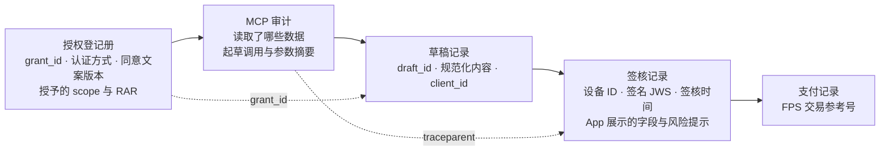
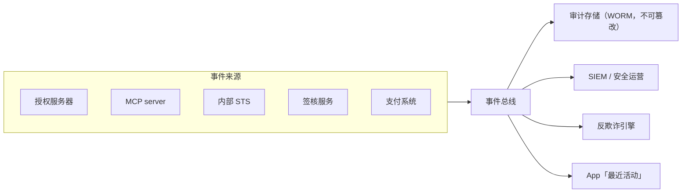

# 第 11 篇｜治理与合规：审计、风控联动与香港监管要求

> 系列：《让 AI 替你办银行业务：面向 MCP Connector 的身份认证与授权设计》
> 监管基线：香港为主线，中国大陆、欧盟作对照；撰写日期 2026-10-23
> 声明：本篇为技术视角的梳理，不构成法律或合规意见。标注「二手资料」之处，撰写时未能取得监管原文逐字核对。

---

## 0. 出了问题，能不能说清楚

设想这样一个投诉：「我从来没让 AI 给这个人转钱。」银行需要在很短时间内回答：

- 这笔付款的草稿是**谁**的授权下生成的？
- 通过**哪个 AI 客户端**？
- 基于**哪一次授权**——什么时候建立的、用什么方式认证的、授予了什么范围？
- AI 在起草前**读过什么**？
- 用户在 App 里**看到了什么、签了什么**？

前十篇的设计，大部分都在为这一刻准备证据。本篇把审计、风控和监管要求串起来。

---

## 1. 审计事件模型

### 1.1 四个问题，一组字段

| 问题 | 字段 | 来源 |
|---|---|---|
| 谁 | `sub`（成对假名）→ 内部映射为 CIF | access token |
| 通过哪个 AI 客户端 | `client_id`、客户端展示名与域名 | access token、客户端登记 |
| 基于哪次授权 | `grant_id`、`token_jti_hash`、授权时的 `acr`／`amr`／`auth_time` | access token、授权登记册 |
| 做了什么 | `tool`、`params_digest`、`outcome`、`draft_id`、`core_txn_ref` | MCP server、草稿服务、支付系统 |
| 怎么串起来 | `traceparent` | MCP `2026-07-28` 规定了在 `_meta` 中传递 OpenTelemetry trace context 的约定 |

示例实现（[`audit.ts`](../code/mcp-server/src/audit.ts)）在本地测试中产生的真实事件：

```json
{
  "event_id": "7802afe8-5924-4fab-b2cc-4ccbefcd613e",
  "ts": "2026-10-23T13:39:01.359Z",
  "channel": "ai_connector",
  "sub": "cif_123",
  "client_id": "examplebank-claude-hosted",
  "grant_id": "grt_2",
  "action": "draft",
  "tool": "create_payment_draft",
  "outcome": "draft_created",
  "draft_id": "drf_lCjMxtAEtQztTEeVXaMH8g",
  "params_digest": { "payee_ref": "pay_Ab12", "amount": "3000", "currency": "HKD" }
}
```

### 1.2 记什么、不记什么

- **记录引用和金额，不记录自由文本。** `params_digest` 只有收款人引用、金额、币种。AI 填写的「用途」不进审计主记录——它可能包含注入内容，写进下游系统反而成为新的攻击面。需要时单独存证，标注为不可信数据。
- **不记录 token 原文**，只记录 `jti` 的哈希。
- **拒绝也要记录**。`outcome: "denied"` 加 `reason`（超出 RAR、grant 已撤销、客户端已停用），是发现注入试探和配置问题的主要线索。

### 1.3 一笔付款的完整证据链



投诉发生时，银行可以出示：用户在某时以已绑定设备授权了 Claude 起草付款（附同意文案版本）；AI 在某时起草了这笔付款；用户在某时于已绑定设备上看到了收款人、金额和「由 AI 起草」标识，并以生物识别签名，签名与执行内容一致。**这条链上没有一个环节依赖 AI 平台提供的日志。**

### 1.4 存储与流向



- 审计存储采用不可篡改（WORM）方式，保存期限按银行既有的交易记录保存政策；
- 同一事件流驱动 App 授权管理中心的「最近活动」（第 8 篇）——用户看到的和银行审计的是同一份事实。

---

## 2. 风控联动

### 2.1 AI 渠道是一个独立渠道

在反欺诈引擎中，AI connector 应该有独立的渠道代码（示例中的 `channel: "ai_connector"`），而不是混在网银或开放 API 里。原因：

- 行为基线不同：AI 的调用节奏、查询模式与人手操作差异很大；
- 风险因子不同：prompt injection、跨工具外泄是 AI 渠道独有的；
- 处置手段不同：可以只暂停 AI 渠道，而不影响用户使用 App。

### 2.2 输入特征与处置

| 特征 | 处置 |
|---|---|
| 新建授权后短时间内起草大额付款 | 签核时增加冷静期或额外提示 |
| 起草给长期未交易或首次交易的收款人 | 签核界面显著提示 |
| 草稿被拒绝比例异常 | 暂停 grant，App 通知用户 |
| refresh token 重用 | 撤销 grant（第 8 篇） |
| token 从 AI 平台出站网段之外使用 | 拒绝并撤销 grant（第 7 篇） |
| 设备重新绑定、疑似受骗标记 | 撤销该用户全部 AI 授权（第 8 篇） |
| 收款人命中可疑账户提示 | 高风险提示 ≥ 10 秒（HKMA「Cancel suspicious payments」） |

---

## 3. 香港监管要求

### 3.1 AI 治理：HKMA「ART」框架与代理式 AI 概念说明（2026-10）

2026 年 10 月 15 日，HKMA 宣布「ART」框架（Accountability、Resilience、Trust），作为 Fintech 2030 策略的一部分，并发布负责任采用 AI 的最新监管指引，同时预告一份关于**代理式 AI（agentic AI）**监管框架的讨论文件，拟探讨「以意图为锚的问责（intent-anchored accountability）」「重要 AI agent 登记册」和「有效的干预机制」。HKMA 新闻稿同时提到，GenA.I. Sandbox 第二期中超过 60% 的用例探索了代理式 AI。以上内容已对照 HKMA 新闻稿核对。

据二手资料，相关通函编号为 B1/15C，附件 A 列出 ART 下的九项原则并取代 HKMA 2019 年的 AI 高层原则；附件 C 是关于代理式 AI 治理的概念说明，**明确表示现阶段不构成具体监管要求**。二手资料归纳的原则包括：董事会批准的 AI 策略与治理；每个已部署用例有明确负责人与人工监督；维护包括第三方与嵌入式 AI 在内的 AI 使用清单；按重要性进行生命周期管理；数据、第三方与网络风险管理；输出质量；可解释性；公平对待客户。概念说明中提到：把 agent 的行为与其业务意图、授权的自主程度和问责人挂钩；从「human in the loop」逐步走向「human on the loop」；干预手段包括暂停 agent 的工具访问、紧急停止（kill switch），以及在对客户有重大影响的动作前设置检查点；并界定 agent 可访问的工具、系统和数据范围。**以上细节为二手资料，落地前须以 HKMA 原文为准。**

本系列的设计与这些方向的对应关系：

| ART／概念说明中的方向 | 本系列的对应设计 |
|---|---|
| AI 使用清单（含第三方 AI） | 把 AI connector 登记为一项 AI 用例，第三方 AI 平台列入清单 |
| 明确负责人与人工监督 | connector 的业务负责人；每笔资金操作的人工签核（第 9 篇） |
| 以意图为锚的问责 | 每个工具的意图声明与能力分级表（第 2 篇） |
| 界定可访问的工具、系统、数据 | scope 词表、RAR、Token Exchange 的内部 token 范围（第 5、6 篇） |
| 暂停工具访问、kill switch | grant 暂停／撤销、按 `client_id` 一键下线（第 8 篇） |
| 重大影响动作前的检查点 | 草稿 + 已绑定设备签核（第 9 篇） |
| 数据、第三方、网络风险 | 数据最小化（第 10 篇）、第三方尽调（本篇第 5 节） |

值得注意的是，概念说明讨论的主要是**银行自己部署的 agent**。本系列的场景是**客户使用第三方 AI 平台**访问银行服务，银行既是服务提供方，也要对这个渠道做治理。两种场景的监管定性可能不同，这一点值得在与 HKMA 的沟通中明确。

### 3.2 生成式 AI 的消费者保护（2024-08）

HKMA 2024 年 8 月 19 日发出通函《Consumer Protection in respect of Use of Generative Artificial Intelligence》，把 2019 年大数据分析与 AI 消费者保护指导原则（治理与问责、公平、透明与披露、数据隐私与保护）延伸到面向客户的生成式 AI 应用。据二手资料，其中包括董事会与高级管理层对生成式 AI 相关决策负全责、确保公平一致的结果、向客户披露、以及让客户可以选择不使用生成式 AI 并要求人工处理等要求。

对 AI connector 的启示：

- **透明**：同意页与签核界面明确告知「由 AI 起草」「数据将发送至 AI 服务提供者处理」；
- **可选择不用**：AI 渠道的所有能力，客户都可以在 App 或网银中自己完成，AI 不是唯一入口；总开关允许一键停用；
- **人工处理**：AI 起草的交易出现争议时，有明确的人工处理流程。

### 3.3 网上银行安全：「E-Banking Security ABC」（2025-04）与 TM-E-1

本系列多处引用的这份通函附件，三项措施都与 AI connector 直接相关：

| 措施 | 要求（摘要） | 本系列对应 |
|---|---|---|
| A — Authenticate in-App | 有 App 的客户，登录与高风险交易默认通过已绑定设备认证，不用短信 OTP；设备绑定与重新绑定用人脸识别等严格方式 | 授权建立与每笔签核都在已绑定设备完成（第 4、9 篇） |
| B — Bye to unused functions | 客户可停用网上登记第三方收款人与网上调高转账限额；重新启用须严格核实身份；为未登记收款人设定更低默认限额 | AI 不能登记收款人、不能调高限额；RAR 仅限已登记收款人（第 2、5 篇） |
| C — Cancel suspicious payments | 「高风险」可疑账户提示至少显示 10 秒 | 签核界面的风险提示（第 9 篇） |

HKMA 监管政策手册单元 TM-E-1《Risk Management of E-banking》是网上银行风险管理的基础要求，上述通函也引用了它。AI connector 是一个新的电子银行渠道，应纳入 TM-E-1 框架下的风险评估与控制。

### 3.4 开放 API 框架

HKMA 2018 年发布《银行业开放 API 框架》，分四个阶段推进；HKMA 网站上有各行第三、四阶段功能的实施状态表。AI connector 与开放 API 的关系需要银行明确：它是开放 API 的一种新的消费形式，还是一个独立渠道？无论哪种，第三方尽调、客户同意、安全基线这些开放 API 框架下的原则都适用。本系列第 6 篇建议两者在技术上使用不同的受众、不同的风控模型。

### 3.5 个人资料：PDPO 与 PCPD 指引

- **使用限制（DPP3）**：客户数据交给 AI 平台处理，是否在原收集目的之内？建议在同意页上明确告知，并取得明确同意。
- **资料处理者（DPP2(3)、DPP4(2)）**：如果 AI 平台在法律上被视为银行的资料处理者，银行须以合约等方式确保其保留期限与安全措施。但在本系列的场景中，客户是自行选择 AI 平台并授权其访问，AI 平台更像是客户的服务提供者。**两种定性对应完全不同的合规义务，需要法律意见。**
- **交易对手的资料**：流水中的对手方姓名是第三方个人资料（第 2 篇），数据最小化有助于降低风险。
- PCPD 2024 年 6 月发布《人工智能（AI）：个人资料保障模范框架》，2025 年 3 月发布雇员使用生成式 AI 的指引清单，可作为银行内部治理的参考。

### 3.6 关键基础设施

《保护关键基础设施（电脑系统）条例》于 2025 年通过、2026 年 1 月 1 日起实施。若银行被指定为关键基础设施营运者，新增的互联网暴露面（MCP server、授权服务器扩展）应纳入其安全管理计划和事故通报流程。

---

## 4. 对照：中国大陆与欧盟

| 议题 | 香港（主线） | 中国大陆 | 欧盟 |
|---|---|---|---|
| 强认证 | HKMA「E-Banking Security ABC」、TM-E-1 | 网上银行与支付相关规定；JR/T 0185-2020《商业银行应用程序接口安全管理规范》 | PSD2 及 RTS（2018/389，2022/2360 修订）；PSD3／PSR 已于 2025-11 达成政治协议、2026-04 公布最终妥协文本，撰写时尚待正式通过 |
| 开放接口 | HKMA 开放 API 框架 | JR/T 0185-2020 | PSD2 账户信息与支付发起服务 |
| 个人资料 | PDPO、PCPD 指引 | 《个人信息保护法》、JR/T 0171-2020《个人金融信息保护技术规范》 | GDPR |
| **跨境** | PDPO 第 33 条跨境转移限制尚未生效 | **向境外 AI 平台提供个人信息属于数据出境**，须按安全评估、标准合同或认证路径办理；还涉及数据安全法下的重要数据识别 | GDPR 第五章 |
| AI 治理 | HKMA ART 框架、生成式 AI 消费者保护通函 | 《生成式人工智能服务管理暂行办法》等 | AI Act（Regulation (EU) 2024/1689）：自然人信用评估属于高风险用途；聊天机器人等有透明度义务 |
| 第三方 ICT 风险 | HKMA 外包与运营韧性相关要求 | 金融监管总局数据安全与外包相关要求 | **DORA**（2025-01-17 起适用）：ICT 第三方风险管理、信息登记册、合同要求 |

两点特别提示：

- **中国大陆**：除了数据出境问题，还要考虑所接入的 AI 服务在境内是否可合法提供。本表仅作概念对照。
- **欧盟**：如果 AI 平台被视为代表客户访问账户的第三方，可能触及 PSD2 下账户信息服务提供商的定性。这是欧盟银行在设计时必须先回答的问题。

---

## 5. 第三方风险：对 AI 平台的尽调问题清单

AI 平台保管着银行签发的 token，也处理着银行客户的数据。尽调至少覆盖：

| 类别 | 问题 |
|---|---|
| 凭证保管 | access token 与 refresh token 如何加密存储？密钥如何管理？哪些人员与系统可以访问？ |
| 客户端能力 | 是否支持 DPoP 或 mTLS？是否支持 `private_key_jwt`？是否支持 PAR？路线图如何？ |
| 客户端身份 | CIMD 文档托管在哪里？如何防止被篡改？机密客户端密钥如何保管？ |
| 数据处理 | 工具返回的数据是否会被记录、保留多久、是否用于模型训练、在哪个地区处理？ |
| 隔离 | 同一会话中多个 connector 的数据与工具如何隔离？如何防范工具投毒？ |
| 撤销 | 用户在 AI 平台断开 connector 时，是否调用银行的撤销端点？ |
| 网络 | 出站网段是否固定、变更时如何通知？ |
| 事件 | 发生安全事件时的通报时限与渠道？ |
| 认证 | SOC 2、ISO 27001 等第三方认证报告？ |
| 退出 | 合作终止时如何确保所有 token 被销毁？ |

---

## 6. 治理文档清单

| 文档 | 内容 | 对应 |
|---|---|---|
| AI 用例登记 | connector 的业务意图、负责人、第三方 AI 平台清单 | ART：AI 使用清单 |
| 能力分级表 | 每个工具的四维评估与等级，风险与合规签署 | 第 2 篇 |
| scope／RAR 词表 | 版本化，变更走评审 | 第 5 篇 |
| FAPI 差距与风险接受声明 | 第 7 篇模板 | 第 7 篇 |
| 工具定义变更记录 | 名称、描述、schema 的每一次修改 | 第 10 篇 |
| 第三方尽调报告 | 第 5 节问题清单 | 本篇 |
| 应急预案 | 按客户端一键下线、批量撤销、对客户沟通 | 第 8 篇 |
| 红队测试报告 | 第 10 篇用例 | 第 10 篇 |

---

## 给银行的设计决策清单

1. **建立以 `grant_id` 为主线的证据链**：授权登记册、MCP 审计、草稿、签核、支付记录逐一可追溯，审计只记录引用与金额，不依赖 AI 平台的日志。
2. **把 AI connector 作为独立渠道接入反欺诈引擎**，使用独立的行为基线与处置手段，并与账户事件联动撤销。
3. **按 HKMA ART 框架登记 AI 用例**：明确负责人、意图与边界、第三方 AI 平台；用 kill switch、grant 暂停与逐笔签核落实「干预机制」，并在落地前以 HKMA 原文核对通函要求。
4. **就 AI 平台的法律定性取得法律意见**（客户的服务提供者，还是银行的资料处理者／外包方），并据此确定 PDPO 下的义务与合约安排。
5. **对 AI 平台完成第三方尽调**，覆盖凭证保管、客户端能力、数据处理与训练使用、撤销、事件通报，并纳入年度复审。

---

## 参考资料

- HKMA, *HKMA announces "ART" Framework to promote responsible A.I. adoption*（新闻稿，2026-10-15）. <https://www.hkma.gov.hk/eng/news-and-media/press-releases/2026/10/20261015-3/>
- RegReporting Desk, *HKMA ART Framework: Nine AI Principles for Hong Kong Banks*（二手资料）. <https://regreportingdesk.com/hkma-art-framework-responsible-ai-guidance/>
- HKMA, *Consumer Protection in respect of Use of Generative Artificial Intelligence*（通函，2024-08-19）.
- HKMA, *New Anti-Digital Fraud Measures: "E-Banking Security ABC"*（附件，2025-04-11）. <https://brdr.hkma.gov.hk/gb_chi/doc-ldg/docId/getPdf/20250411-3-EN/20250411-3-EN.pdf>
- HKMA, *Supervisory Policy Manual TM-E-1: Risk Management of E-banking*.
- HKMA, *Open API Framework for the Hong Kong Banking Sector*（2018）及第三、四阶段实施状态. <https://www.hkma.gov.hk/eng/key-functions/international-financial-centre/fintech/open-application-programming-interface-api-for-the-banking-sector/target-dates/>
- PCPD, *Artificial Intelligence: Model Personal Data Protection Framework*（2024-06）；*Checklist on Guidelines for the Use of Generative AI by Employees*（2025-03）.
- 《保护关键基础设施（电脑系统）条例》（香港，2026-01-01 实施）.
- 中国人民银行, JR/T 0185-2020《商业银行应用程序接口安全管理规范》；JR/T 0171-2020《个人金融信息保护技术规范》.
- European Union, Regulation (EU) 2022/2554（DORA）；Regulation (EU) 2024/1689（AI Act）；Delegated Regulation (EU) 2018/389 及 2022/2360.
- William Fry, *PSD3/PSR final compromise texts are published*（2026）. <https://www.williamfry.com/knowledge/psd3-psr-final-compromise-texts-are-published/>
- Model Context Protocol Specification `2026-07-28`, *Key Changes*（OpenTelemetry trace context 约定）. <https://modelcontextprotocol.io/specification/2026-07-28/changelog>
