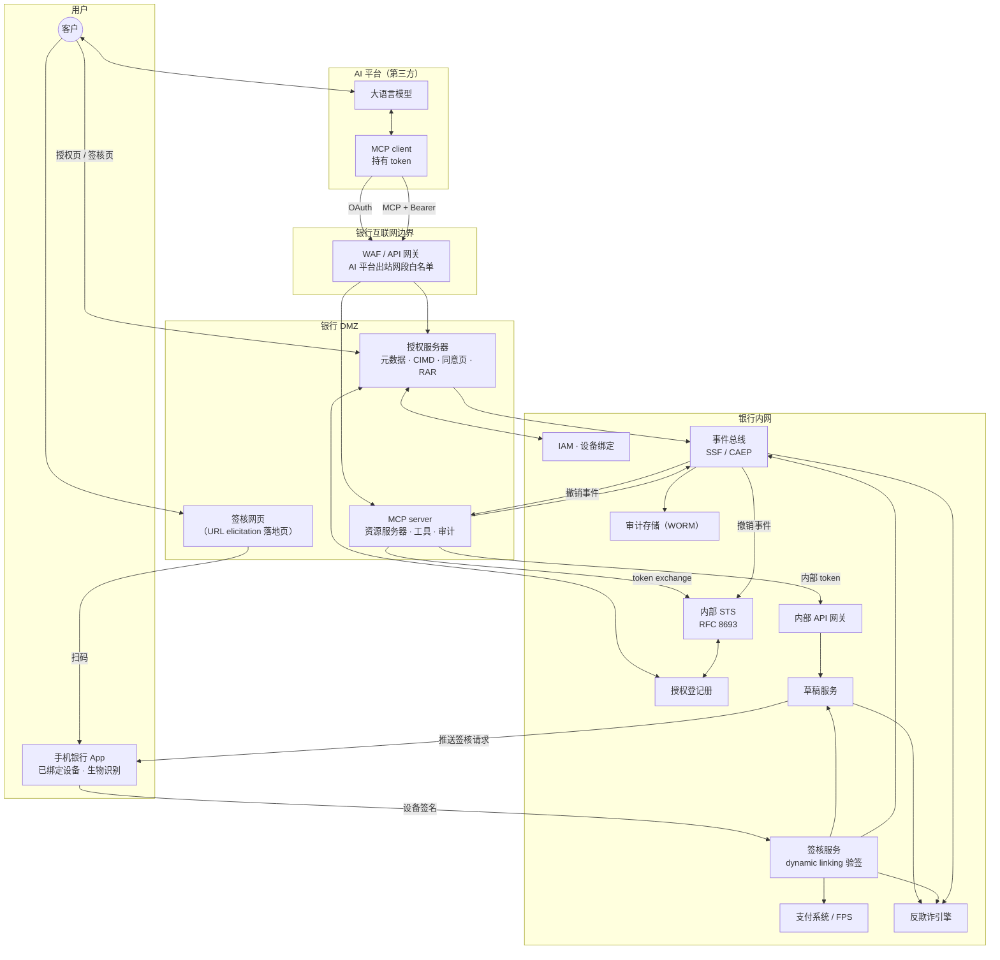
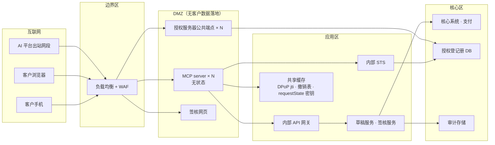
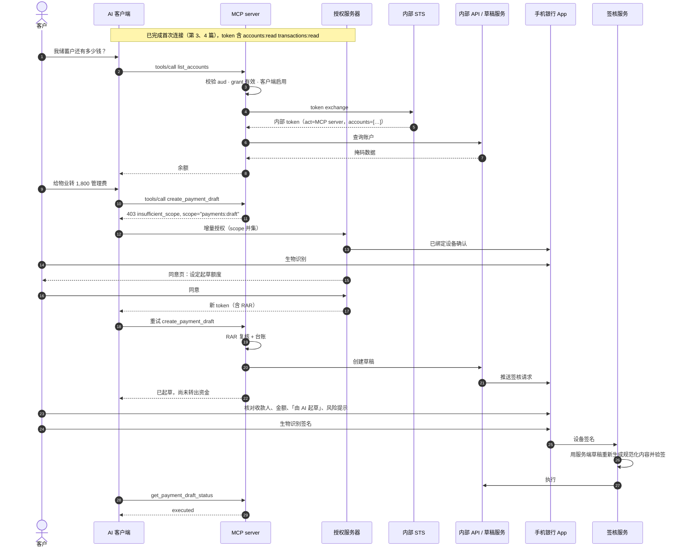

# 第 12 篇｜落地篇：参考架构、骨架代码与上线检查清单

> 系列：《让 AI 替你办银行业务：面向 MCP Connector 的身份认证与授权设计》
> 代码基线：`@modelcontextprotocol/server` 2.3.1（实现 MCP `2026-07-28`）、`@modelcontextprotocol/node` 2.1.1、`@modelcontextprotocol/express` 2.0.2、`jose` 6.2.13、Python 3 标准库
> 撰写日期：2026-10-23

---

## 0. 把十一篇拼起来

前十一篇分别讨论了场景分级、认证、授权、AI 风险和治理。这一篇把它们拼成一套可以落地的方案：一张参考架构图、一份可以跑起来的骨架代码、一份授权服务器配置、一份上线检查清单，以及分阶段上线的路线。

本仓库的 `code/` 目录包含：

- `code/mcp-server/`：TypeScript MCP server 骨架，已通过 `tsc --noEmit` 类型检查，并在本地完成了端到端冒烟测试；
- `code/authz-server/`：Python 的授权服务器策略组件（CIMD 信任策略、RAR 收紧与同意文案、token 生命周期策略）与单元测试，以及 AS 元数据示例。

---

## 1. 参考架构



组件职责一览：

| 组件 | 职责 | 相关篇章 |
|---|---|---|
| WAF / API 网关 | 限定 AI 平台出站网段；限流；TLS | 7 |
| MCP server | 401 挑战与 PRM；token 校验（`aud`、grant 状态、客户端开关、DPoP）；工具；scope challenge；RAR 复核；审计 | 3、5、6、7、8、10 |
| 授权服务器 | 元数据；CIMD 允许名单；已绑定设备认证编排；同意页与 RAR 生成；token 签发与轮换；撤销 | 3、4、5、7、8 |
| 授权登记册 | grant 状态机；账户范围；同意文案版本；历史 | 4、8 |
| 内部 STS | Token Exchange；还原 CIF；写入 `act`、`channel`、账户范围 | 6 |
| 草稿服务 | 草稿状态机；幂等；推送签核请求 | 9 |
| 签核服务 | 拉取草稿给 App；dynamic linking 验签；一次性；触发执行 | 9 |
| 事件总线 | 撤销事件；审计事件；风控事件 | 8、11 |
| 反欺诈引擎 | AI 渠道独立模型；签核时的风险提示 | 9、11 |

---

## 2. 部署拓扑



部署要点：

- **MCP server 无状态、可水平扩展**，正好契合 MCP `2026-07-28` 去掉会话之后的协议形态。跨请求的状态（草稿、撤销表、DPoP `jti`）放在共享存储中；
- **requestState 的 HMAC 密钥在所有实例间共享**，否则客户端重试落到另一个实例会校验失败（SDK 文档对此有明确提示）；
- **DMZ 中不落地客户数据**；
- **授权服务器的发现与 token 端点要同样放行 AI 平台网段**，并满足 Claude 的响应时限（发现、注册、token 10 秒；refresh 30 秒）。

---

## 3. 端到端时序：查余额 → 起草转账 → App 签核 → 完成



---

## 4. 骨架代码导读

### 4.1 目录结构

```text
code/
├── mcp-server/                     TypeScript，MCP 2026-07-28
│   ├── package.json
│   ├── tsconfig.json
│   └── src/
│       ├── server.ts               入口：PRM、认证闸门、createMcpHandler
│       ├── config.ts
│       ├── audit.ts                审计事件（第 11 篇）
│       ├── coreApi.ts              内部 API 演示桩
│       ├── auth/
│       │   ├── middleware.ts       401/403 挑战、DPoP 方案、grant 与客户端开关（第 3、7、8 篇）
│       │   ├── verifier.ts         RFC 9068 JWT 校验：iss、aud、typ、算法（第 6 篇）
│       │   ├── dpop.ts             RFC 9449 证明校验（第 7 篇）
│       │   ├── scopes.ts           scope 词表（第 5 篇）
│       │   ├── rar.ts              RAR 类型与复核（第 5 篇）
│       │   ├── tokenExchange.ts    RFC 8693（第 6 篇）
│       │   └── grants.ts           撤销表、客户端开关（第 8 篇）
│       ├── tools/
│       │   ├── accounts.ts         L0 只读（第 2、10 篇）
│       │   ├── cards.ts            L1：只有冻结（第 2 篇）
│       │   └── payments.ts         L2：草稿 + MRTR URL elicitation（第 9 篇）
│       └── drafts/
│           ├── store.ts            草稿状态机、幂等、owner 绑定（第 9 篇）
│           └── approval.ts         dynamic linking 验签（第 9 篇）
└── authz-server/                   Python 3，标准库
    ├── as_metadata.json            AS 元数据示例（第 3 篇）
    ├── cimd_policy.py              CIMD 允许名单与 SSRF 防护（第 3 篇）
    ├── rar_consent.py              RAR 收紧与繁体中文同意文案（第 5 篇）
    ├── token_policy.py             token 生命周期策略（第 7、8 篇）
    └── test_authz.py               单元测试
```

### 4.2 入口：把各层串起来

```ts
// server.ts（节选）
const codec = createRequestStateCodec<DraftState>({
  key: config.requestStateKey,
  ttlSeconds: 15 * 60,
  bind: (ctx) => {
    const sub = (ctx.http?.authInfo?.extra as { sub?: string } | undefined)?.sub ?? '';
    return `${ctx.mcpReq.method}\0${sub}`;
  },
});

function buildServer(): McpServer {
  const server = new McpServer(
    { name: 'examplebank-hk', version: '0.1.0' },
    { requestState: { verify: codec.verify } },
  );
  registerAccountTools(server);
  registerCardTools(server);
  registerPaymentTools(server, codec);
  return server;
}

const mcpHandler = createMcpHandler(() => buildServer(), { legacy: 'reject' });

app.post(config.resourceUrl.pathname, express.json({ limit: '64kb' }), bankAuth, (req, res) =>
  toNodeHandler(mcpHandler)(req, res, req.body),
);
```

几个 SDK v2 的要点：

- `createMcpHandler` 按请求用工厂创建服务器实例，服务 `2026-07-28` 协议；`legacy: 'reject'` 表示不服务 2025 年版本的客户端。若需要兼容旧客户端，改为 `'stateless'`；
- `createMcpHandler` **本身不做 token 校验**，`authInfo` 由前置中间件放在 `req.auth` 上，`toNodeHandler` 转交给工具的 `ctx.http.authInfo`；
- 工具上的 `scopeChallenge: requireScopes(...)` 由 SDK 生成符合 MCP 规范的 `403 insufficient_scope` 挑战；
- `requestState` 在 SDK 层统一校验，篡改或过期直接返回 `-32602`，工具代码看到的永远是已验证的内容。

### 4.3 运行

```bash
cd code/mcp-server
npm install
npm run typecheck
npm run build
MCP_RESOURCE_URL=https://mcp.examplebank.hk/mcp \
AS_ISSUER=https://auth.examplebank.hk \
AS_JWKS_URL=https://auth.examplebank.hk/jwks \
INTERNAL_STS_URL=https://sts.internal.examplebank.hk/token \
REQUEST_STATE_KEY=$(openssl rand -base64 48) \
npm start

cd ../authz-server
python3 -m unittest -v test_authz
```

### 4.4 本地测试记录

撰写时在本地用自签发的 JWKS 和内部 STS 桩完成了以下测试：

| 测试 | 结果 |
|---|---|
| 无 token 访问 `/mcp` | `401`，`WWW-Authenticate` 含 `resource_metadata` 与基础 scope |
| 访问 PRM | 返回 `resource`、`authorization_servers`、`scopes_supported` |
| `aud` 错误的 token | `401 invalid_token` |
| 合法只读 token 调用 `tools/list` | 返回工具列表（含 `readOnlyHint` 等注解与 `outputSchema`） |
| 只读 token 调用 `create_payment_draft` | `403 insufficient_scope, scope="payments:draft"` |
| RAR 单笔 / 累计上限 | 超限拒绝，范围内建立草稿 |
| URL 模式 elicitation | 返回 `input_required`；带 `requestState` 重试返回同一草稿状态 |
| 篡改 `requestState` | `-32602 Invalid or expired requestState` |
| 对篡改内容签核 / 对原始内容签核 | 拒绝 / 通过 |
| Python 单元测试 | 10 项全部通过 |

骨架代码用内存结构代替了数据库、事件总线、推送服务，生产化时需要逐一替换（见各文件注释）。

### 4.5 生产化改造清单

| 骨架中的实现 | 生产替换 | 关注点 |
|---|---|---|
| `drafts/store.ts` 内存 Map | 草稿服务 + 数据库 | 幂等键唯一索引；按 `owner_sub` 查询；过期任务 |
| `auth/grants.ts` 内存撤销表 | 事件驱动的本地撤销表 + 定期同步 | 撤销传播延迟；事件丢失兜底 |
| `middleware.ts` 中的 DPoP `jti` Map | 共享键值存储，带 TTL | 多实例一致；容量 |
| `tokenExchange.ts` 的缓存与 STS 调用 | mTLS 客户端认证；与撤销事件联动的缓存 | STS 失败时闭合 |
| `coreApi.ts` 桩 | 内部 API 网关 | 只从内部 token 取用户身份与账户范围 |
| `audit.ts` 写 stdout | 事件总线 → WORM 存储、SIEM、反欺诈 | 不可篡改；不记录自由文本与 token 原文 |
| `config.ts` 中的开发密钥 | 密钥管理系统 | `REQUEST_STATE_KEY` 多实例共享、定期轮换 |
| `approval.ts` 的设备公钥参数 | 设备绑定服务 | 只接受 active 且属于草稿所有者的设备 |

### 4.6 可观测性

除了第 8 篇的运营指标，上线后还应持续观察：

| 指标 | 用途 |
|---|---|
| 401 / 403 比例，按原因（aud、过期、撤销、客户端停用、scope） | 发现配置错误与攻击 |
| 增量授权的触发次数与完成率 | 评估 scope 设计是否合理 |
| 草稿创建量、签核率、拒绝率、过期率、签核耗时 | 评估签核体验与注入风险 |
| refresh 频率与失败原因 | 评估 token 生命周期设置与端点容量 |
| 工具调用延迟（含 Token Exchange） | 容量规划 |
| 每个 grant 的数据读取量分布 | 发现异常读取与外泄 |

所有指标都按 `client_id` 分维度，以便在多个 AI 平台接入后分别评估。

---

## 5. 授权服务器配置

### 5.1 元数据

完整示例见 [`as_metadata.json`](../code/authz-server/as_metadata.json)。与 AI 客户端交互的关键字段已在第 3 篇说明。

### 5.2 客户端登记（与产品无关的描述）

```yaml
clients:
  - client_id: examplebank-claude-hosted          # Anthropic 托管的机密客户端（第 3、7 篇）
    display: { name: Claude, domain: claude.ai, verified: true }
    type: confidential
    token_endpoint_auth_method: client_secret_basic   # FAPI 差距，见第 7 篇风险接受
    redirect_uris: [ "https://claude.ai/api/mcp/auth_callback" ]
    grant_types: [ authorization_code, refresh_token ]
    allowed_resources: [ "https://mcp.examplebank.hk/mcp" ]     # 只允许一个受众（第 6 篇）
    allowed_scopes: [ accounts:read, transactions:read, cards:read, alerts:write,
                      budgets:write, cards:freeze, payments:draft, offline_access ]
    allowed_authorization_details_types: [ "https://examplebank.hk/rar/payment-draft/v1" ]
    require_consent_every_time: true                  # 不因已有会话跳过（第 4 篇）
    authn_policy: bound_device_only                   # 不提供短信 OTP（第 4 篇）
    token_policy: { profile: confidential_bearer }    # token_policy.py
    source_networks: [ "160.79.104.0/21" ]           # 第 7 篇
    enabled: true                                     # 一键下线开关（第 8 篇）

cimd:
  enabled: true
  trusted_hosts: [ claude.ai ]                         # 允许名单（第 3 篇）
  allow_loopback_redirects: true                       # 仅当需要支持 Claude Code
  fetch: { https_only: true, block_private_ranges: true, follow_redirects: false, max_bytes: 5120 }

dcr:
  enabled: false                                       # 不开放（第 3 篇）
```

### 5.3 选型时要实测的能力

| 能力 | 用途 |
|---|---|
| RFC 8707 `resource` 与 `aud` 绑定，未知资源返回 `invalid_target` | 第 6 篇 |
| CIMD（含 `client_id_metadata_document_supported` 元数据） | 第 3 篇 |
| RFC 9207 `iss` 授权响应参数 | 第 3 篇 |
| RFC 9396 RAR，且允许在同意环节由服务端生成 `authorization_details` | 第 5 篇 |
| 自定义认证编排（扫码、App-to-App、已绑定设备） | 第 4 篇 |
| refresh token 家族轮换与重用检测 | 第 8 篇 |
| RFC 8693 Token Exchange（含 `act`） | 第 6 篇 |
| DPoP、PAR、CIBA | 第 7、9 篇 |
| SSF / CAEP 事件发布 | 第 8 篇 |

部分开源与商业授权服务器已开始支持 CIMD，但成熟度差异较大，撰写时笔者未能逐一核实各产品的版本与特性，选型时应以实测为准。

---

## 6. 上线检查清单

### 协议与连通性

- [ ] 未认证请求返回 `401` 与 `resource_metadata`，并给出最小基础 scope
- [ ] PRM 的 `resource` 与用户输入的 URL 逐字符一致；`authorization_servers` 只有一项
- [ ] AS 元数据含 `code_challenge_methods_supported: ["S256"]`、`authorization_response_iss_parameter_supported: true`
- [ ] AS 元数据 `issuer` 与 well-known URL 构造所用值完全一致
- [ ] CIMD：同时声明支持标记与 `none` 认证方式；允许名单与 SSRF 防护上线
- [ ] DCR 关闭
- [ ] 回调地址 `https://claude.ai/api/mcp/auth_callback` 已登记
- [ ] token 端点接受 form-urlencoded；refresh 失效返回 `invalid_grant`
- [ ] 发现、token 端点 P99 远低于 10 秒

### 认证

- [ ] 授权页仅支持已绑定设备认证（扫码 / App-to-App），无短信 OTP 路径
- [ ] 每次 AI 授权都展示同意页；同意页显示回调主机名，禁止 iframe 嵌入
- [ ] 授权建立、范围扩大均推送 App 通知
- [ ] `sub` 为成对假名；token 中无姓名、电话、客户号、真实账号

### 授权与 token

- [ ] scope 词表评审通过：无执行类 scope、无通配符
- [ ] RAR JSON Schema 发布；AS 按政策收紧并拒绝执行类动作
- [ ] AI 客户端 token 只允许一个受众；未知 `resource` 返回 `invalid_target`
- [ ] MCP server 校验 `iss`、`aud`、`typ`、算法、`exp`；每个请求检查 grant 状态与客户端开关
- [ ] 代码评审确认无 token passthrough；内部调用一律经 Token Exchange
- [ ] access token 5–15 分钟；refresh token 家族轮换与重用检测
- [ ] 来源网段限制生效
- [ ] DPoP：对带 `cnf.jkt` 的 token 强制校验证明
- [ ] FAPI 差距风险接受声明已签署

### 工具与数据

- [ ] 每个工具完成四维评估与定级
- [ ] 不存在解冻、调高限额、登记收款人、执行付款等工具
- [ ] 只读工具：掩码、引用、分页上限、不回传自由文本、无批量导出
- [ ] 工具 schema 中无「已确认」类参数
- [ ] 工具结果中无 URL（elicitation 签核页除外）
- [ ] 工具定义纳入变更管理，`tools/list` 顺序确定

### 签核

- [ ] 草稿 ID 不可猜测且绑定 `owner_sub`；幂等键必填；15 分钟过期
- [ ] App 签核界面只展示银行渲染字段，标注「由 AI 起草」，风险提示 ≥ 10 秒
- [ ] dynamic linking 验签；签名一次性
- [ ] 工具回复措辞在执行前始终为「已起草、尚未转出资金」
- [ ] `requestState` HMAC 密钥在所有实例间共享并定期轮换

### 审计、风控与运营

- [ ] 审计事件含 `sub`、`client_id`、`grant_id`、工具、参数摘要、结果，写入 WORM
- [ ] 拒绝事件同样记录
- [ ] AI 渠道独立接入反欺诈引擎
- [ ] 设备重新绑定、疑似受骗标记触发撤销全部 AI 授权
- [ ] 撤销传播 P99 ≤ 5 秒（事件路径），兜底 ≤ 60 秒
- [ ] 按 `client_id` 一键下线完成演练
- [ ] App 授权管理中心上线（列表、范围、额度消耗、最近活动、暂停、撤销、总开关）
- [ ] 第 10 篇红队用例纳入回归测试

### 治理与合规

- [ ] AI 用例登记（负责人、意图、边界、第三方 AI 平台）
- [ ] 对照 HKMA ART 框架、生成式 AI 消费者保护通函、「E-Banking Security ABC」、TM-E-1 完成差距评估
- [ ] PDPO 法律意见（AI 平台的定性与合约安排）
- [ ] 第三方尽调完成
- [ ] 客户告知文案（同意页、App、条款）经合规审阅

---

## 7. 分阶段上线

| 阶段 | 范围 | 对象 | 进入下一阶段的条件 |
|---|---|---|---|
| 0 | L0 只读 | 内部员工 | 连通性清单全部通过；无 P1 安全缺陷；审计链可完整还原 |
| 1 | L0 只读 | 小范围客户（邀请制） | 撤销演练达标；风控模型有基线；客户投诉与撤销原因已分析 |
| 2 | + L1 安全向写操作 | 扩大客户范围 | 授权管理中心使用率与通知触达率达标 |
| 3 | + L2 起草与签核（仅已登记收款人，低额度） | 小范围 | 草稿拒绝率、签核时长、风险提示效果评估；红队复测通过 |
| 4 | L2 额度逐步放宽；理财、外汇草稿 | 扩大 | 适当性流程与 App 签核联调完成 |
| 5 | L3 对公 | 试点企业 | maker-checker 集成；对公操作员认证方案经评审 |

每个阶段都保留**回退开关**：按 `client_id` 下线、按 scope 停用、全局暂停 AI 渠道。

---

## 8. 结语：五条贯穿全系列的原则

1. **AI 的终点是草稿。** 资金变动的最终意思表示，只能由用户本人在银行控制的界面、在已绑定设备上完成。
2. **确定性防线优先。** 工具不存在、授权不允许、签名对不上——这些不依赖模型判断的控制，才是安全的基础。
3. **安全方向不对称。** 让账户更安全的操作可以放宽，让账户更危险的操作必须收紧。
4. **凭证不越界。** token 只对一个受众有效，不穿过 MCP server，用户身份随凭证而不是随参数流动。
5. **用户看得见、管得住。** 授权管理中心、即时通知、一键撤销，让用户对 AI 的授权始终是一个可见、可控的对象。

---

## 给银行的设计决策清单

1. **按第 1 节参考架构划定组件与信任区**：MCP server 与授权服务器在 DMZ 且无状态，草稿、签核、STS、授权登记册在内网，签核服务不在 MCP 路径上。
2. **以本仓库骨架为起点做 PoC**，优先替换内存结构为生产组件（授权登记册 DB、共享缓存、事件总线、推送服务），并保持 `tsc` 类型检查与第 4.4 节测试作为持续集成门禁。
3. **授权服务器选型以第 5.3 节能力表实测为准**，缺失 RFC 8707、CIMD 或 RAR 的产品不应通过在 MCP server 内自建 OAuth 门面来弥补。
4. **第 6 节检查清单作为上线门禁**，由安全、风险、合规三方共同签署。
5. **按第 7 节分阶段上线**，每阶段设定量化的进入条件与回退开关，L2 从「仅已登记收款人、低额度」起步。

---

## 参考资料

- 本系列第 1–11 篇。
- Model Context Protocol Specification `2026-07-28`. <https://modelcontextprotocol.io/specification/2026-07-28>
- MCP TypeScript SDK（v2，实现 `2026-07-28`）. <https://github.com/modelcontextprotocol/typescript-sdk>
- Anthropic, *Authentication for connectors*. <https://claude.com/docs/connectors/building/authentication>
- OpenID Foundation, *FAPI 2.0 Security Profile*（Final）. <https://openid.net/specs/fapi-security-profile-2_0-final.html>
- HKMA, *"E-Banking Security ABC"*（附件，2025-04-11）；*ART Framework* 新闻稿（2026-10-15）.
